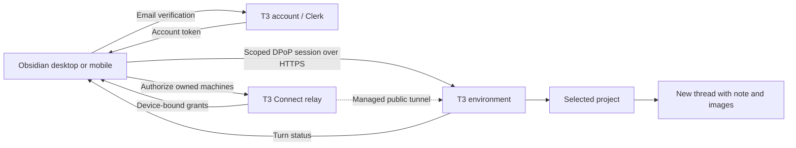

# Send to T3 Code

One Obsidian plugin for desktop and mobile. Chat from the command palette, send a Markdown note to a T3 project, or create a folder workflow. Linked folders choose the destination for notes below them. Manual sends preserve Markdown and embedded images.

## Folder workflows and event capture

Link a folder to a T3 project, then long press or right-click it and choose **Setup T3 workflow → Setup new workflow…**. Describe when the workflow should run and what it should do. Creating it starts a T3 thread showing your description and a short pointer to temporary setup instructions under `.obsidian/t3-code/setup/`. The agent reads those instructions and writes a JSON setup result there; the coordinator validates its trigger, scope, and task, saves the enabled workflow, and removes both temporary files. Keep the coordinator's Obsidian client open for setup and workflow execution.

To change an existing workflow, open it from the same folder menu. The edit box starts empty. **Save changes** sends your request as a new turn in the original setup thread; normal workflow runs continue in their own threads. The current workflow remains active until the coordinator validates and activates the proposed revision. If a change request is unresolved, cancel it from the edit dialog before sending another.

With no enabled workflows, the plugin does not record or publish observations. It removes the old visible `T3 Automation` and `T3 Workflow Setup` folders after loading, including copies returned through Sync. Each enabled workflow subscribes to only its selected event types and folder scope. The engine seeds note baselines silently so a later update has a known previous state. Pausing or removing the last workflow stops capture. Changing subscriptions starts a new stream, so old unpublished observations cannot be released later.

For captured saved revisions, immutable JSON records under `.obsidian/t3-code/automation/` include exact line changes and relevant metadata. These files stay outside the visible vault tree and Obsidian Sync; paired mobile clients send them directly to the coordinator through the authenticated T3 connection. Records can contain private note text. The coordinator validates the records, runs matching workflows, and answers bounded event-history queries. A workflow action receives query instructions only when its definition requests history access. That agent may request history for the event types and paths a workflow records; events outside those subscriptions do not exist in the journal.

Workflows start paused by default. Enabling one does not run it against existing notes. The coordinator records matching future events, waits through the debounce period, persists a run plan, and sends it to the linked T3 project. Recent run states and uncertain delivery retries appear in settings. A changed input note or folder destination stops delivery for review.

## Setup: desktop and mobile

1. Install and run T3 Code on your computers. Sign in to the same T3 account and enable **T3 Connect** on each destination. T3 supplies the public HTTPS connection; no Tailscale or plugin companion is required. See [T3 remote access](https://github.com/pingdotgg/t3code/blob/main/docs/user/remote-access.md).
2. Install `main.js` and `manifest.json` in `<vault>/.obsidian/plugins/send-to-t3-code/` and enable the plugin.
3. In **Settings → Send to T3 Code**, keep **T3 Connect (recommended)** selected. Enter your T3 account email and click **Send sign-in code**.
4. Enter the six-digit code from T3’s email and click **Verify and connect**. The plugin discovers your account’s computers, authorizes each online connection and scans its projects automatically. No terminal commands, machine URLs, pairing links or per-machine codes are needed.
5. Enable the projects you want in the note menu. Their names include the destination computer. On mobile, use the note menu → **Open in T3 Code**, or the **Send current note** command.

Sign in once on each device. Project choices, connection names, and folder links sync, but account credentials do not. Until this device is signed in and its machine/project discovery completes, the settings page shows only the sign-in or connection-progress screen. Projects, computers, orchestration, folder links, manual pairing, and saved-request controls remain hidden so synced names cannot be mistaken for a live connection. **Refresh connections** retries discovery and authorization. The plugin refreshes connections after reopening Obsidian and renews account-managed sessions before they expire when used. This never resends notes or queues work.

This is an independent integration with T3’s existing native authentication and relay APIs. Email verification uses T3’s Clerk native frontend API, enabled by T3, and its `t3-relay` token template. The relay accepts that credential and issues device-bound connection grants. The plugin requests only environment thread read/operate scopes. It does not read installed T3 credentials or browser cookies, impersonate an existing device session, register a replacement `t3code://` handler, or need access to your email inbox. It does not collect your T3 password or create a new T3 account.

Account/session tokens stay in device-local, vault-specific Obsidian storage and are not OS-keychain encrypted. The device’s non-extractable DPoP signing key stays in local IndexedDB. Neither is written to the synced vault. Email verification codes are not retained. **Sign out** removes account credentials and account-managed environment sessions on this device, and asks T3 to revoke this sign-in session. Independently paired manual connections are retained. If revocation cannot reach T3, the plugin reports that local sign-out succeeded and directs you to T3’s account controls for remote revocation. A cancelled or expired sign-in does not restore account access later.

Sources: [T3 relay authorization](https://github.com/pingdotgg/t3code/blob/main/infra/relay/src/http/Api.ts), [T3 managed account authentication](https://github.com/pingdotgg/t3code/blob/main/apps/web/src/cloud/managedAuth.tsx), [Clerk email-code sign-in](https://clerk.com/docs/guides/development/custom-flows/authentication/email-sms-otp), and [Clerk native API behavior](https://clerk.com/docs/guides/development/errors/frontend-api).

### Advanced: manual pairing

After account connection finishes, existing manual pairings still work. Expand **Advanced: manual pairing** to use a known HTTPS environment address and a fresh T3 pairing code or link. A hosted `https://app.t3.codes/pair?host=…#token=…` link is accepted. Manual pairing is available without account sign-in. Each device pairs separately; manual sessions require pairing again after their displayed expiry. Re-pairing preserves selections and pending requests.

T3’s Connections page currently hides its pairing controls when Network access and Tailscale HTTPS are both off, even when T3 Connect is enabled. In that case the official `t3 auth pairing create --ttl 10m --label Obsidian --json` command on the destination can issue a code without changing its network settings. This command is **not needed for the recommended account setup**.

Manual pairing exchanges a one-time code for a scoped bearer session. The code is discarded, and the session remains only on this device. **Forget pairing** removes the local credential; revoke its client session in T3 Settings → Connections to revoke server access. Remote connections require HTTPS and refuse redirects; HTTP is allowed only for loopback testing.

### Advanced: this computer only

Desktop users can choose **This computer only (advanced)** to use local T3 without account sign-in. Install T3 and its matching official CLI. The plugin discovers the CLI in standard locations or PATH; executable and data-directory overrides are available if needed. Scan projects and select the ones you want. The CLI issues five-minute sessions for T3’s authenticated loopback API, which the plugin revokes after each operation. No shell interpolation, Python or Fleet adapter is used. This option is unavailable on mobile.

The destination must remain online. There is no offline queue or automatic resend. An interrupted send is saved for **manual Retry** with its exact original commands, preventing duplicate threads after a lost response. Completion monitoring uses the same connection while Obsidian is active.

New threads use the selected machine's T3 model defaults: an explicit project override takes precedence over the environment default. Configured model options, including reasoning effort, are preserved; previous threads do not supply the model or reasoning settings. If T3 is set to automatic selection, the plugin uses an enabled provider's advertised default model. Existing-thread sends retain that conversation's model. Saved retries replay their original model and commands even if defaults have since changed.

## What belongs to T3, and what belongs to this plugin?

| Component | Owner |
| --- | --- |
| Projects, threads, model execution, image attachments and turn status | T3 Code |
| Pairing codes, scoped sessions and orchestration HTTP endpoints | T3 Code |
| T3 Connect account, native email verification, managed HTTPS tunnel, discovery and device-bound grants | T3 Code |
| Obsidian sign-in UI, automatic connection/renewal client, project menu, image extraction and completion actions | This plugin |
| Old HTTPS companion and its SSH/Python forwarding | Custom component removed in 2.1 |
| Fleet adapter and persistent delivery queue | Not used by this plugin |



Account connections and manual pairing use T3's existing protocols, not an official Obsidian SDK or a guarantee of long-term API stability. Sources: [T3 auth endpoints](https://github.com/pingdotgg/t3code/blob/main/apps/server/src/auth/http.ts), [remote client implementation](https://github.com/pingdotgg/t3code/blob/main/packages/client-runtime/src/authorization/remote.ts), and [pairing URL construction](https://github.com/pingdotgg/t3code/blob/main/apps/web/src/components/settings/pairingUrls.ts).

## Upgrade

Install the newest release and reload the plugin on each device after Sync finishes. Existing manual connections, project selections, and folder links remain. Previous v1 workflow and tag trigger definitions are no longer loaded or shown. Each device clearly requires its own email verification before synced projects and folder links become visible. The old HTTPS companion mode and bundled Python/SSH code are removed. Devices previously using that mode now open **T3 Connect** and can use the account setup above. Old service URLs, keys and remote project catalogs are removed from the active settings. Local desktop settings and direct connections remain available.

Old unconfirmed sends remain visible for review but cannot be retried through the removed mode. Check the original thread in T3 before creating another send, since the earlier request may have started. Discard only removes the local retry record. Old companion completion jobs keep their notes and stop monitoring. Direct/local completion monitoring continues. No request is automatically rerouted or sent during migration.

The obsolete companion service is no longer part of the plugin. Its operator can stop/remove it after upgrading their clients. Historical state backups may be retained privately, but neither companion nor queue files are read by this plugin.

## Command palette chat

Open Obsidian’s command palette (Ctrl/⌘ + P, or your configured mobile swipe-down action) and type a message. **T3 Chat: “your message”** stays at the top alongside normal commands. Select it with Enter or a tap, then choose **New thread** or **Existing thread…**. Existing threads are listed newest first and labelled **Active** or **Idle**. The typed text is preserved and followed by the Obsidian vault/path context and, when a workflow is enabled, event-history query instructions. When the destination has a known mapping to the synced vault, chat also includes the distinct destination filesystem path. A new thread uses the first line of your message as its title. Chat does not read or copy the note’s Markdown or embedded images.

The nearest linked folder supplies the destination, including for notes in subfolders. Without a folder link, or with no Markdown note open, chat uses the vault-root link. If that association is missing or its project is no longer discovered, mobile opens **Connect vault** and keeps the original prompt ready. On desktop, connected machines offer the same chooser with **This computer** as an additional option; without remote connections, the plugin can still discover or create the local vault project automatically using the official T3 CLI.

Manage the default under **Settings → Send to T3 Code → Orchestration → Vault project machine → Connect vault / Change machine**. Choose any machine discovered through your T3 account or manual pairing, then select **Find vault**. The plugin checks remembered locations and registered projects for this vault's synced identity. Select a matching folder, or use the remote folder browser to find its existing synced copy. **Use this folder** verifies the identity, reuses or creates a project on that machine, saves the association, and resumes the original chat action. Cancelling setup leaves the prompt open. An offline machine leaves setup open for retry or another choice.

Vault identity, known machine locations, and the chosen root association sync in plugin settings; session credentials and unfinished project-registration commands remain device-local. Enable community-plugin settings in Obsidian Sync on both devices. A matching name alone never connects a folder: different local vault names are fine, but the synced identity must match. With headless Sync, no running desktop Obsidian instance is needed on the destination. The selected computer must already have a synced copy; this feature neither provisions a new Sync account nor uploads a replacement vault.

Newly connected remote vaults check that the referenced note appears in the destination folder before sending, briefly waiting for Obsidian Sync if it is missing. This checks file presence, not whether every edit or attachment has finished syncing. Local desktop sends use the absolute note path. Self-linked remote folders use their project root, while other remote folder links use a root link on the same connection as the destination-vault mapping. If no safe mapping exists, chat reports the vault name and relative path once rather than inventing or duplicating a filesystem path.

The regular **Send to T3 Code: New T3 chat** command opens a message editor using the same automatic routing. It works as a hotkey/mobile toolbar action and is the fallback when the live palette row is unavailable. The note context is captured when chat opens. Switching notes while composing or retrying does not change that context. The live row uses isolated, version-checked internal command-palette methods because Obsidian does not expose a public dynamic-result API; keep the core Command palette plugin enabled.

Chat retains the optional wait instruction, 120,000-character limit (including note context), and manual retry handling. It never enrolls the note for archive/delete cleanup. Choosing **Delete note** or **Archive note** therefore does nothing to a note referenced by command-palette chat. An unconfirmed send must be retried through **Unconfirmed requests → Retry**, which preserves the original prompt, note path, destination, and command IDs.

## Inline responses

Under **Settings → Send to T3 Code → Inline responses**, **Stream Ask T3 into the editor** and **Stream Send to T3 into the editor** are both on by default. Each can be turned off independently. New T3 chat remains a thread-only conversation.

Manually sending a note with **Open in T3 Code** or **Send current note** appends a streamed reply at the end of that note. The plugin opens the note in a Markdown tab if needed. It captures the note content before inserting the response, sends that content and its images to T3, and instructs T3 to answer in the thread rather than edit the note. A streamed note stays in place even if archive or delete is selected under **When task completes**. Folder workflows do not stream into the editor. Turning either switch off affects new sends; an already active response continues to completion or until stopped.

## Ask T3 inline

Select text in a Markdown editor and choose **Ask T3** from the editor menu. Choose **New thread** or **Existing thread…**. The plugin sends the selection and captured note path to T3, then inserts a tracked response below the selected line. It streams the assistant's text into that response, shows the latest tool or approval status, and marks the response complete when the T3 turn ends. The T3 agent is instructed to answer in its thread and leave the note untouched; the plugin owns the note insertion.

With Ask T3 streaming off, the same selection and note path are sent, and T3 answers in its thread without adding a response to the note.

On mobile, selecting text in the Markdown editor shows a small **Ask T3** button above the selection. Tap it to open the same thread chooser; no mobile toolbar setup is needed. The button disappears when the selection is cleared or another note becomes active. **Ask T3 about selected text** is also available as an editor command for accessibility and as a fallback. The iOS Cut/Copy/Paste menu itself cannot host plugin actions.

The response is surrounded by small HTML comment markers so it can be found after edits elsewhere in the note, file/view switches, or a plugin reload. Obsidian hides these tracking lines in its editor; they remain in the raw Markdown for safe updates and may be visible in other text editors. The plugin only replaces its own response when the previous content still matches. If you edit or remove the response while it is streaming, updates stop instead of overwriting your changes. A closed note catches up when reopened. Markdown code fences in a partial answer are temporarily closed while streaming. Selecting text inside a fenced block places the response after the closing fence; an unclosed fence must be closed first.

An active response offers **Stop T3 response** in the editor menu, which requests an interrupt for that T3 turn. Approval and question prompts are signaled in the note and through an Obsidian notice; respond in the T3 app. Full reasoning traces and tool payloads are not copied into the note. Inline job metadata is device-local, while the visible answer and markers sync with the note. A device without that local job will not start a second stream for the synced response.

## Orchestration

Settings → Send to T3 Code → **Orchestration → Wait for other threads** is off by default. Enable it to prepend this instruction to each new note or chat prompt:

> Before starting work on the task below, wait for all other active T3 Code threads in this project to finish. Exclude this thread and threads in other projects. Check their status periodically, and begin work only when no other threads in this project are active. If you cannot check thread status, ask the user before proceeding.

The setting persists per vault. This is an instruction to the receiving agent; the plugin does not enforce a project lock or wait before delivery. There is no delivery queue. It requires the agent to be able to check T3 thread status. The remaining note content and image references are unchanged. Retries use the originally saved prompt, even if this setting changes afterward.

## Folder links

Right-click a folder and choose **Link to T3 Code → Link to <project>**. Confirm the link in the dialog. Links appear under **Settings → Send to T3 Code → Linked folders** and route manual chat and note sends. Saving a link alone does not send notes.

On desktop, **Link to self** registers the folder as a project in the local T3 Code installation using the official `t3 project add` command, then saves the resolved project ID and workspace root. Arguments are passed directly to the executable without a shell. If T3 already has a project for that path, the existing project is reused. Mobile can save links to discovered projects, but cannot register its private mobile filesystem as a project on another computer.

Folder links sync with the vault. T3 credentials remain device-local. Each explicitly linked folder shows the **T3 logo followed by its linked project name** beside the folder name in the Files explorer on desktop and mobile. A folder with configured workflows but no explicit folder link shows only the T3 logo—never the inherited vault/project name. Any folder with workflows gives its logo a subtle turquoise glow. Other descendants remain unmarked. Long project names truncate to fit the sidebar, with the full name available in the tooltip and accessibility label. The indicator updates when links or workflows are added, removed, renamed, or synced.

### Sending notes into linked projects

For a note inside a linked folder, **Open in T3 Code** offers **Send to new thread** and **Send to existing thread…**. The existing-thread option loads a searchable list of that project’s unarchived threads, newest first, with each thread labelled **Active** or **Idle**. Nested links take precedence. On mobile, or when native submenus are unavailable, tapping the action opens the same two choices. A missing linked project reports an error instead of rerouting the note.

Both choices send the full Markdown and embedded images. Existing-thread sends preserve its model, runtime permissions and interaction mode. An idle thread starts another turn; a running thread receives input through T3’s steering behavior. Resolve pending approvals or structured input in T3 before sending another note. Retries reuse the original thread and message IDs without creating a new thread. Sending to an existing thread keeps the note and supersedes any older cleanup job for that note; archive/delete completion handling applies only to new-thread note sends.

### Folder workflows

Right-click or long press a linked folder and choose **Setup T3 workflow**. The submenu lists workflows in that folder and offers **Setup new workflow…**. See [Folder workflows and event capture](#folder-workflows-and-event-capture) for capture and execution behavior.

## When task completes

For note sends to new threads, under **Orchestration → When task completes**, choose **Keep note** (default), **Archive note**, or **Delete note (vault trash)**. Archive has a configurable vault-relative folder, defaulting to `Archive/T3 Code`; it preserves the note’s original subfolders and adds a numeric suffix if a destination already exists. Delete moves only the Markdown note to this vault’s `.trash`; embedded image files remain in place.

The plugin polls the destination T3 environment every 30 seconds while Obsidian is active. Mobile can suspend the app; checks resume when reopened. The completion signal is the original sent turn reporting `completed`, with its session idle (ready or stopped), no pending approval/input, and its original user message and final assistant message verified. This is a T3 lifecycle signal, not a judgment that the answer fully solved the task. Failed/interrupted turns and conversations that have advanced to additional turns keep the note.

The completion action and note fingerprint are saved when sending. Later setting changes affect new sends only; retries preserve the original action. Monitoring resumes after Obsidian restarts and retries connection errors. **Task completion monitoring** shows status and offers **Check now**, **Stop monitoring**, and **Dismiss**. Starting a newer send for the same note supersedes its previous cleanup action once that send is confirmed.

Notes edited, replaced, renamed, or left with unsaved editor changes are kept. Archive/delete runs in the sending Obsidian vault, including when the T3 thread runs on another computer. Existing notes and previously sent threads are not automatically enrolled.

## Embedded images

Supported embeds: `![[image.png]]`, `![[folder/image.png|300]]`, ``, reference-style Markdown images, HTTPS image URLs, and base64 image data URLs. Local links use Obsidian’s resolver relative to the source note, including attachment folders and percent-encoded paths. Images inside code blocks, inline code, frontmatter, and escaped wiki embeds are ignored.

PNG, JPEG, GIF, and WebP bytes are uploaded through T3’s native attachment API. Each original embed is replaced by a native `t3-context://` reference, so the image stays at that point in the message. Repeated images reuse one attachment; all other Markdown is unchanged. Neither the note nor its images are moved or modified in the vault. HTTPS downloads use Obsidian’s `requestUrl` with no access key or authorization headers added. Mobile downloads are buffered by Obsidian before the byte limit can be checked; for large remote images, download a resized copy into the vault first.

Limits: 8 distinct images, 10 MiB per image, 20 MiB combined, and T3’s 120,000-character prompt limit. Missing images, failed downloads, HTML `` embeds, unsupported formats such as SVG/HEIC, and limit violations stop the send with an error instead of silently omitting images. Convert unsupported formats to PNG/JPEG first. Non-image wiki transclusions (notes/PDF/audio) remain as Markdown and are not expanded. Image-only notes work.

The plugin includes image support. The selected T3 model/provider must accept image input. Direct pairing is verified against T3 0.0.43-nightly.20260917.1866; local integration was also tested against 0.0.43-nightly.20260916.1811; recheck compatibility after T3 upgrades.

## Empty states and recovery

Empty notes are rejected without creating a thread. For unlinked note sends, no selected projects shows a clear disabled menu item and a project selector. Linked-folder sends and palette chat use their folder/root association independently of the project-menu selection toggles. Failed scans report the error and preserve the last discovered list; unavailable selections are retained for later rediscovery. Sending to a removed project reports an error without scheduling delivery.

A request is saved before dispatch. During sending, additional sends are disabled. If a response is lost or fails, **Unconfirmed requests** in settings offers **Retry** using the exact original content, connection, and request ID. Do this instead of clicking New thread again, which intentionally creates a separate request. **Discard** removes only saved local retry data; it does not cancel or delete any T3 thread. Restarting Obsidian does not resend anything automatically.

Pending requests store the full note and base64 image bytes in local IndexedDB until confirmed/discarded. Direct mode stores the complete immutable commands in device-local IndexedDB before dispatch, without a server-side plugin journal. Local desktop integration keeps a private request journal under the T3 data directory (`send-to-t3-code/desktop`). Journals retain prompt/image bytes to retry exactly; they contain no session credentials. In local mode, T3 credentials are issued through its official CLI and revoked after use. Direct pairing sessions stay in device-local app storage. Official CLI output is bounded and each CLI operation times out after 45 seconds. Note contents and image payloads travel in authenticated HTTP request bodies, never shell commands or CLI arguments.

## Development and release pipeline

The canonical source checkout is `/home/ubuntu/projects/send-to-t3-code`. It is deliberately separate from both installed copies:

- `/home/ubuntu/Obsidian Vault/.obsidian/plugins/send-to-t3-code` is the development-vault installation and contains only runtime artifacts plus its local `data.json`.
- `/home/ubuntu/vaults/QLO2/.obsidian/plugins/send-to-t3-code` is the QLO2 installation published by Obsidian Sync.

Requires Node.js, npm, and Python 3. Run `npm ci`, `npm run build`, and `npm test`. Build output is `dist/main.js`; a build never writes into a vault. The plugin registers Obsidian's vault/metadata events and editor/file menus. See [Obsidian plugin setup](https://docs.obsidian.md/Plugins/Getting%20started/Build%20a%20plugin).

For a release, run `npm run release:qlo2 -- --bump patch` (or `minor`/`major`) on the VPS. This single entry point aligns all version files, builds, runs the complete test suite, creates a new immutable archive, installs only runtime artifacts in the development vault, backs up QLO2, preserves `data.json`, installs atomically, pauses continuous Sync, forces a fresh one-shot scan, requires `Fully synced`, and restarts continuous Sync. It refuses a dirty worktree unless the user explicitly authorized `--allow-dirty`, refuses an existing archive/receipt, and refuses a version that is not newer than QLO2.

If an immutable archive was created but installation or Sync failed, resume those exact bytes with `npm run release:qlo2 -- --resume VERSION`. Never delete and recreate a versioned archive with different contents.

The deployment receipt is intentionally marked `awaiting-live-smoke`. After a real QLO2 client receives Sync, reload the plugin and exercise the changed behavior. Capture durable evidence and complete the release with:

```sh
npm run release:qlo2 -- --complete-smoke VERSION \
  --device DEVICE \
  --evidence /absolute/path/to/evidence.png \
  --notes "Exact behavior verified"
```

A change is not live or complete until that immutable smoke receipt exists. Backups and receipts live outside the synced vault under `/home/ubuntu/backups/send-to-t3-code`. Direct `scripts/deploy-qlo2.py` use is retired so old instructions cannot bypass versioning, tests, packaging, or smoke evidence. Do not route QLO2 installation through the Windows laptop.

Git tracks the TypeScript source, tests, release tooling, and dependency lockfile. Generated `dist/`, packaged releases, local validation artifacts, and Python caches are ignored.

This is a local community-plugin-format build; it has not been submitted to or approved for the public community directory.

The browser-targeted bundle includes portable hashing and binary utilities. Desktop Node imports live in `desktop.ts`, loaded only after a platform guard. Tests evaluate the built bundle without `process`, global `Buffer`, or access to Node modules, then send an image note through mocked Obsidian APIs. This is a compatibility test, not a substitute for testing on an actual iPhone/Android device.

Release 2.3 passes 32 automated tests covering native email verification, wrong-code/expiry errors, credential rotation, device-bound proof verification, automatic multi-machine connection, partial offline recovery, renewal coalescing, sign-out and cancelled verification. The built mobile bundle is tested without Node APIs. Live desktop validation records are kept locally in the ignored `evidence/` directory; actual iPhone/Android verification remains separate.

Live 2.3 validation in QLO2: one email verification connected both laptop and VPS, plugin reload preserved sign-in, and Files-pane right-click sends to both hosts completed with two correctly recognized images. Original user settings were restored and test notes removed.

Live 2.7 desktop validation: the real command-palette row submitted the exact typed prompt and received a completed T3 response. A linked folder sent nothing with its trigger disabled, sent one tagged note after enabling, and created no duplicates after repeated edits and a rename. Build and all 66 automated tests passed, including mobile-compatible bundle delivery, palette lifecycle, event parsing, folder renames and retry durability. Test notes were removed and original development-vault settings restored.

Version 2.7.1 restores the folder-link dialog with an optional tag switch. Live desktop testing verified Files-menu selection, the inactive default, enabling a tag and explicit persistence. All 69 automated tests pass, including cancel, reopen, ownership preservation and storage-error recovery.

Version 2.8.1 adds the new/existing-thread choice to command-palette chat and labels existing-thread choices **Active** or **Idle**. Active threads remain selectable and use T3's steering behavior. All 87 automated tests pass.

Version 2.8.2 separates the destination filesystem path from the vault-relative path. A same-connection vault-root link maps synced mobile notes to their destination path; without a safe mapping, chat sends the vault name and relative path once rather than duplicating it.

Version 2.8.3 adds live **T3** badges to explicitly linked folders in Obsidian’s Files explorer and clarifies that command-palette chat never triggers archive or delete completion actions.

Version 2.9.0 adds machine selection and remote vault-project setup through existing T3 connections. Synced identity verification supports different vault names and paths across computers. Mobile can browse the selected computer, reuse or register its vault project, and continue the original chat. File access uses T3's authenticated WebSocket API; project creation uses its existing orchestration API. No server-specific hostnames or filesystem paths are embedded in the feature.

Version 2.9.1 replaces the colored folder badges with the T3 logo and linked project name. The label follows the Obsidian theme and truncates long names to fit narrow sidebars.

Version 2.9.2 fixes new threads inheriting a recent conversation's model and reasoning effort. Desktop and mobile now read the selected machine's current T3 settings through its authenticated connection, respecting project overrides and automatic model selection. This applies to command-palette chat, note-menu sends, and tag sends. Existing threads and saved retries retain their original selections.

Version 2.12.0 adds the durable event/coordinator/runtime foundation and the explicit Workflows v1/v2 selector. Only the selected version runs or exposes controls. Switching versions disables and remembers the outgoing version's enabled definitions and restores the selected version's saved set. Both engines now receive events exclusively through the common durable observation pipeline.

Version 2.12.1 makes workflow settings safe across devices. Established vaults no longer rewrite synced settings on startup, device-only state never touches `data.json`, every shared write merges the latest workflow records first, and workflow revisions plus deletion tombstones prevent a stale device from restoring a deleted workflow.
