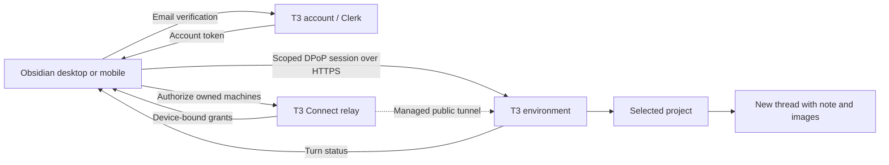

# Send to T3 Code — 2.4.3

One Obsidian plugin for desktop and mobile. Right-click a Markdown note in **Files → Open in T3 Code → New thread in <project>**. The note is sent verbatim, with embedded images attached at their original positions. No vault/path/title wrapper is added; the note title names the thread, without an “Obsidian:” prefix.

**No Fleet adapter is required. No persistent delivery queue exists.** The plugin includes local and portable direct T3 clients. There is no companion service or SSH/Python forwarding. Sends require the selected machine to be online and running T3. After a confirmed start, the T3 turn continues independently of Obsidian.

## Setup: desktop and mobile

1. Install and run T3 Code on your computers. Sign in to the same T3 account and enable **T3 Connect** on each destination. T3 supplies the public HTTPS connection; no Tailscale or plugin companion is required. See [T3 remote access](https://github.com/pingdotgg/t3code/blob/main/docs/user/remote-access.md).
2. Install `main.js` and `manifest.json` in `<vault>/.obsidian/plugins/send-to-t3-code/` and enable the plugin.
3. In **Settings → Send to T3 Code**, keep **T3 Connect (recommended)** selected. Enter your T3 account email and click **Send sign-in code**.
4. Enter the six-digit code from T3’s email and click **Verify and connect**. The plugin discovers your account’s computers, authorizes each online connection and scans its projects automatically. No terminal commands, machine URLs, pairing links or per-machine codes are needed.
5. Enable the projects you want in the note menu. Their names include the destination computer. On mobile, use the note menu → **Open in T3 Code**, or the **Send current note** command.

Sign in once on each device. Project choices and connection names sync, but account credentials do not. Until this device is signed in and its machine/project discovery completes, the settings page shows only the sign-in or connection-progress screen. Projects, computers, orchestration, workflows, manual pairing, and saved-request controls remain hidden so synced names cannot be mistaken for a live connection. **Refresh connections** retries discovery and authorization. The plugin refreshes connections after reopening Obsidian and renews account-managed sessions before they expire when used. This never resends notes or queues work.

This is an independent integration with T3’s existing native authentication and relay APIs. Email verification uses T3’s Clerk native frontend API, enabled by T3, and its `t3-relay` token template. The relay accepts that credential and issues device-bound connection grants. The plugin requests only environment thread read/operate scopes. It does not read installed T3 credentials or browser cookies, impersonate an existing device session, register a replacement `t3code://` handler, or need access to your email inbox. It does not collect your T3 password or create a new T3 account.

Account/session tokens stay in device-local, vault-specific Obsidian storage and are not OS-keychain encrypted. The device’s non-extractable DPoP signing key stays in local IndexedDB. Neither is written to the synced vault. Email verification codes are not retained. **Sign out** removes account credentials and account-managed environment sessions on this device, and asks T3 to revoke this sign-in session. Independently paired manual connections are retained. If revocation cannot reach T3, the plugin reports that local sign-out succeeded and directs you to T3’s account controls for remote revocation. A cancelled or expired sign-in does not restore account access later.

Sources: [T3 relay authorization](https://github.com/pingdotgg/t3code/blob/main/infra/relay/src/http/Api.ts), [T3 managed account authentication](https://github.com/pingdotgg/t3code/blob/main/apps/web/src/cloud/managedAuth.tsx), [Clerk email-code sign-in](https://clerk.com/docs/guides/development/custom-flows/authentication/email-sms-otp), and [Clerk native API behavior](https://clerk.com/docs/guides/development/errors/frontend-api).

### Advanced: manual pairing

After account connection finishes, existing manual pairings still work. Expand **Advanced: manual pairing** to use a known HTTPS environment address and a fresh T3 pairing code or link. A hosted `https://app.t3.codes/pair?host=…#token=…` link is accepted. Each device pairs separately; manual sessions require pairing again after their displayed expiry. Re-pairing preserves selections and pending requests.

T3’s Connections page currently hides its pairing controls when Network access and Tailscale HTTPS are both off, even when T3 Connect is enabled. In that case the official `t3 auth pairing create --ttl 10m --label Obsidian --json` command on the destination can issue a code without changing its network settings. This command is **not needed for the recommended account setup**.

Manual pairing exchanges a one-time code for a scoped bearer session. The code is discarded, and the session remains only on this device. **Forget pairing** removes the local credential; revoke its client session in T3 Settings → Connections to revoke server access. Remote connections require HTTPS and refuse redirects; HTTP is allowed only for loopback testing.

### Advanced: this computer only

Desktop users can choose **This computer only (advanced)** to use local T3 without account sign-in. Install T3 and its matching official CLI. The plugin discovers the CLI in standard locations or PATH; executable and data-directory overrides are available if needed. Scan projects and select the ones you want. The CLI issues five-minute sessions for T3’s authenticated loopback API, which the plugin revokes after each operation. No shell interpolation, Python or Fleet adapter is used. This option is unavailable on mobile.

The destination must remain online. There is no offline queue or automatic resend. An interrupted send is saved for **manual Retry** with its exact original commands, preventing duplicate threads after a lost response. Completion monitoring uses the same connection while Obsidian is active.

## What belongs to T3, and what belongs to this plugin?

| Component | Owner |
| --- | --- |
| Projects, threads, model execution, image attachments and turn status | T3 Code |
| Pairing codes, scoped sessions and orchestration HTTP endpoints | T3 Code |
| T3 Connect account, native email verification, managed HTTPS tunnel, discovery and device-bound grants | T3 Code |
| Obsidian sign-in UI, automatic connection/renewal client, project menu, image extraction and completion actions | This plugin |
| Old HTTPS companion and its SSH/Python forwarding | Custom component removed in 2.1 |
| Fleet adapter and persistent delivery queue | Not used by this plugin |

Account connections and manual pairing use T3's existing protocols, not an official Obsidian SDK or a guarantee of long-term API stability. Sources: [T3 auth endpoints](https://github.com/pingdotgg/t3code/blob/main/apps/server/src/auth/http.ts), [remote client implementation](https://github.com/pingdotgg/t3code/blob/main/packages/client-runtime/src/authorization/remote.ts), and [pairing URL construction](https://github.com/pingdotgg/t3code/blob/main/apps/web/src/components/settings/pairingUrls.ts).

## Upgrade

Install 2.4.3 and reload the plugin on each device after Sync finishes. Existing manual connections and project selections remain intact. Each device clearly requires its own email verification before synced projects and workflow settings become visible. The old HTTPS companion mode and bundled Python/SSH code are removed. Devices previously using that mode now open **T3 Connect** and can use the account setup above. Old service URLs, keys and remote project catalogs are removed from the active settings. Local desktop settings and direct connections remain available.

Old unconfirmed sends remain visible for review but cannot be retried through the removed mode. Check the original thread in T3 before creating another send, since the earlier request may have started. Discard only removes the local retry record. Old companion completion jobs keep their notes and stop monitoring. Direct/local completion monitoring continues. No request is automatically rerouted or sent during migration.

The obsolete companion service is no longer part of the plugin. Its operator can stop/remove it after upgrading their clients. Historical state backups may be retained privately, but neither companion nor queue files are read by this plugin.

## Orchestration

Settings → Send to T3 Code → **Orchestration → Wait for other threads** is off by default. Enable it to prepend this instruction to each new note prompt:

> Before starting work on the task below, wait for all other active T3 Code threads in this project to finish. Exclude this thread and threads in other projects. Check their status periodically, and begin work only when no other threads in this project are active. If you cannot check thread status, ask the user before proceeding.

The setting persists per vault. This is an instruction to the receiving agent; the plugin does not enforce a project lock or wait before delivery. There is no delivery queue. It requires the agent to be able to check T3 thread status. The remaining note content and image references are unchanged. Retries use the originally saved prompt, even if this setting changes afterward.

## Folder workflows

Right-click a folder and choose **Link to T3 Code → Link to <project>**. Folder links include nested folders and appear under **Settings → Send to T3 Code → Orchestration → Workflows**. A note is handled once per folder link. Creating or syncing a note into the folder and moving a note in from outside both count; renaming it within the folder does not create another thread.

- **Instant Build** creates a normal T3 thread immediately. Existing notes are processed once when the link is created.
- **Trigger Mode** creates the thread only when the configured tag is present. Adding the tag later triggers the note once. Tags are case-insensitive.
Workflow links and successful-send receipts sync with the vault. T3 credentials remain device-local. Outbound request IDs are deterministic per folder link and note, and a receipt is saved only after T3 confirms the thread. Failed sends remain eligible for a later vault scan; unconfirmed sends use the existing manual retry list and are never automatically replayed.

## When task completes

Under **Orchestration → When task completes**, choose **Keep note** (default), **Archive note**, or **Delete note (vault trash)**. Archive has a configurable vault-relative folder, defaulting to `Archive/T3 Code`; it preserves the note’s original subfolders and adds a numeric suffix if a destination already exists. Delete moves only the Markdown note to this vault’s `.trash`; embedded image files remain in place.

The plugin polls the destination T3 environment every 30 seconds while Obsidian is active. Mobile can suspend the app; checks resume when reopened. The completion signal is the original sent turn reporting `completed`, with its session idle (ready or stopped), no pending approval/input, and its original user message and final assistant message verified. This is a T3 lifecycle signal, not a judgment that the answer fully solved the task. Failed/interrupted turns and conversations that have advanced to additional turns keep the note.

The completion action and note fingerprint are saved when sending. Later setting changes affect new sends only; retries preserve the original action. Monitoring resumes after Obsidian restarts and retries connection errors. **Task completion monitoring** shows status and offers **Check now**, **Stop monitoring**, and **Dismiss**. Starting a newer send for the same note supersedes its previous cleanup action once that send is confirmed.

Notes edited, replaced, renamed, or left with unsaved editor changes are kept. Archive/delete runs in the sending Obsidian vault, including when the T3 thread runs on the VPS. Existing notes and previously sent threads are not automatically enrolled.

## Embedded images

Supported embeds: `![[image.png]]`, `![[folder/image.png|300]]`, ``, reference-style Markdown images, HTTPS image URLs, and base64 image data URLs. Local links use Obsidian’s resolver relative to the source note, including attachment folders and percent-encoded paths. Images inside code blocks, inline code, frontmatter, and escaped wiki embeds are ignored.

PNG, JPEG, GIF, and WebP bytes are uploaded through T3’s native attachment API. Each original embed is replaced by a native `t3-context://` reference, so the image stays at that point in the message. Repeated images reuse one attachment; all other Markdown is unchanged. Neither the note nor its images are moved or modified in the vault. HTTPS downloads use Obsidian’s `requestUrl` with no access key or authorization headers added. Mobile downloads are buffered by Obsidian before the byte limit can be checked; for large remote images, download a resized copy into the vault first.

Limits: 8 distinct images, 10 MiB per image, 20 MiB combined, and T3’s 120,000-character prompt limit. Missing images, failed downloads, HTML `` embeds, unsupported formats such as SVG/HEIC, and limit violations stop the send with an error instead of silently omitting images. Convert unsupported formats to PNG/JPEG first. Non-image wiki transclusions (notes/PDF/audio) remain as Markdown and are not expanded. Image-only notes work.

The plugin includes image support. The selected T3 model/provider must accept image input. Direct pairing is verified against T3 0.0.43-nightly.20260917.1866; local integration was also tested against 0.0.43-nightly.20260916.1811; recheck compatibility after T3 upgrades.

## Empty states and recovery

Empty notes are rejected without creating a thread. No selected projects shows a clear disabled menu item and a project selector. Failed scans report the error and preserve the last discovered list; unavailable selections are retained for later rediscovery. Sending to a removed project reports an error without scheduling delivery.

A request is saved before dispatch. During sending, additional sends are disabled. If a response is lost or fails, **Unconfirmed requests** in settings offers **Retry** using the exact original content, connection, and request ID. Do this instead of clicking New thread again, which intentionally creates a separate request. **Discard** removes only saved local retry data; it does not cancel or delete any T3 thread. Restarting Obsidian does not resend anything automatically.

Pending requests store the full note and base64 image bytes in local IndexedDB until confirmed/discarded. Direct mode stores the complete immutable commands in device-local IndexedDB before dispatch, without a server-side plugin journal. Local desktop integration keeps a private request journal under the T3 data directory (`send-to-t3-code/desktop`). Journals retain prompt/image bytes to retry exactly; they contain no session credentials. In local mode, T3 credentials are issued through its official CLI and revoked after use. Direct pairing sessions stay in device-local app storage. Official CLI output is bounded and each CLI operation times out after 45 seconds. Note contents and image payloads travel in authenticated HTTP request bodies, never shell commands or CLI arguments.

## Development

Requires Node.js and npm. Run `npm ci`, `npm run build`, and `npm test`. Build output is `main.js`. The plugin registers Obsidian's `file-menu` event and uses the runtime `MenuItem.setSubmenu()` extension, with a project picker fallback if unavailable; mobile uses the picker. See [Obsidian plugin setup](https://docs.obsidian.md/Plugins/Getting%20started/Build%20a%20plugin).

Git tracks the TypeScript source, tests and dependency lockfile. The generated `main.js`, packaged releases, local validation artifacts and Python caches are ignored. Building creates the `main.js` required for installation; ignoring it does not remove an installed copy.

This is a local community-plugin-format build; it has not been submitted to or approved for the public community directory.

The browser-targeted bundle includes portable hashing and binary utilities. Desktop Node imports live in `desktop.ts`, loaded only after a platform guard. Tests evaluate the built bundle without `process`, global `Buffer`, or access to Node modules, then send an image note through mocked Obsidian APIs. This is a compatibility test, not a substitute for testing on an actual iPhone/Android device.

Release 2.3 passes 32 automated tests covering native email verification, wrong-code/expiry errors, credential rotation, device-bound proof verification, automatic multi-machine connection, partial offline recovery, renewal coalescing, sign-out and cancelled verification. The built mobile bundle is tested without Node APIs. Live desktop validation records are kept locally in the ignored `evidence/` directory; actual iPhone/Android verification remains separate.

Live 2.3 validation in QLO2: one email verification connected both laptop and VPS, plugin reload preserved sign-in, and Files-pane right-click sends to both hosts completed with two correctly recognized images. Original user settings were restored and test notes removed.
