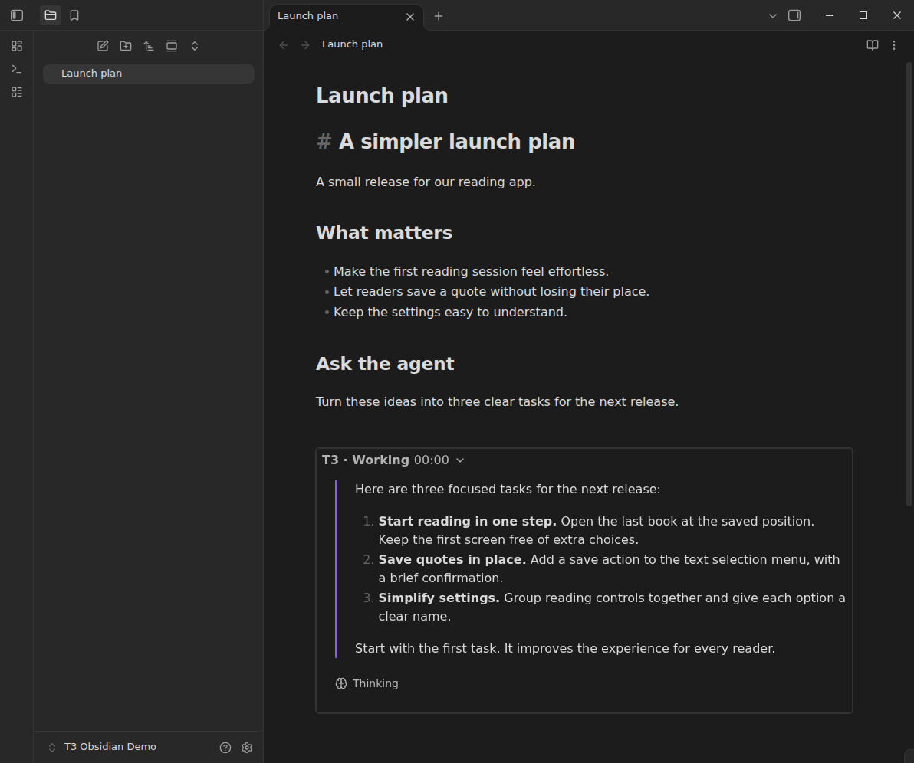
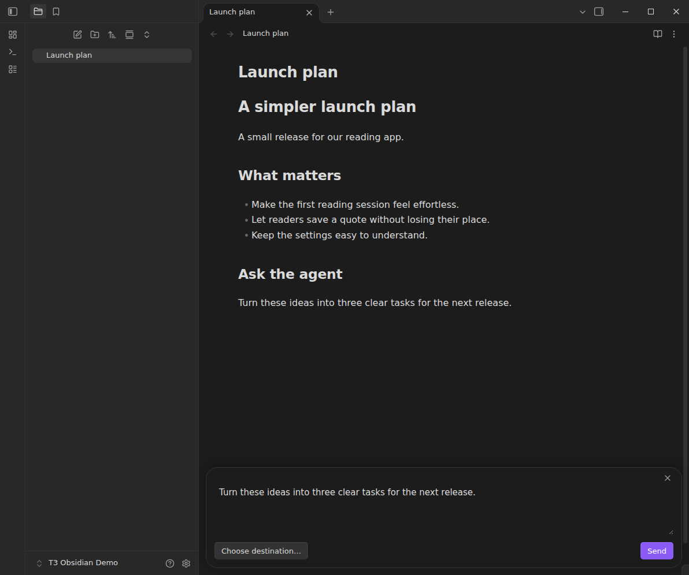

# T3 Code

The **t3-obsidian** plugin brings [T3 Code](https://github.com/pingdotgg/t3code) into your Obsidian notes. Send a note or selection to an agent, ask questions in the editor, and read replies as they arrive.

The plugin appears as **T3 Code** in Obsidian. This is an independent community plugin, with support for desktop and mobile.

The plugin connects to an existing T3 Code environment on this computer or another computer through **T3 Connect (recommended)**, direct HTTPS (including Tailscale HTTPS), or an SSH tunnel set up outside Obsidian. Obsidian is a client; the plugin does not include or start a T3 server.

## Get started

You need Obsidian **1.13.0 or later** and a running T3 Code installation with Orchestrator v2.

1. Install **T3 Code** from **Settings → Community plugins → Browse**, then enable it. Manual installs are available from [GitHub releases](https://github.com/7bgsbm749g-boop/t3-obsidian/releases).
2. In T3 Code, sign in and enable **T3 Connect** on the computer you want to use.
3. Open **Settings → T3 Code → Connection** in Obsidian. Enter your T3 account email, choose **Send sign-in code**, then enter the code and choose **Verify and connect**. Your computers and projects appear automatically. Sign in on each device you use.

For a local, HTTPS/Tailscale, or existing SSH tunnel connection, choose that method under **Settings → T3 Code → Connection** and use a fresh T3 pairing link or code. Start SSH tunnels outside Obsidian.

## Work from your notes

- **Send a note or selection.** Use **Send to agent** from the editor menu, or **T3 Code** from the command palette. Choose a new conversation or continue an existing thread.
- **Ask a question.** Use **Ask agent** to open the composer. Selected text becomes context for your question.
- **Follow the reply.** Responses stream into the note. Expand progress to see the agent’s activity, answer its questions, or stop the response. The finished reply becomes Markdown in your note.
- **Continue your work.** Later sends can reuse the note’s previous thread. Smart Send avoids sending the same automatic note context again.

## Connect notes and projects

- **Link a folder.** Right-click it, choose **Link to T3 Code**, then choose a project. Notes below it use that project when you send them.
- **Import a response.** Use **Import T3 run into this note…** from the editor menu or command palette. Choose an existing response without sending a new message. Search or cancel while earlier runs load. Hover on a run or use the arrow keys to preview its response, including HTML. Status icons keep the list compact, and unavailable runs are hidden. Imports use standard T3 Code connections and preserve the complete saved response.
- **Catch up on responses.** After a response has streamed into a note, use **Catch up on responses** from the editor menu or command palette to import later responses from T3 Code. One thread needs one click. If several threads have streamed into the note, select which ones to catch up on. Existing responses and future stream settings stay the same.
- **Browse project files.** Run **Open Codebase view** from the command palette to work with code, Markdown, images, and supported documents.

Use **Settings → T3 Code → Replies** to adjust reply behaviour, and **Projects** to manage folder links. **Advanced** includes troubleshooting.

**Hide Obsidian threads in T3**, under **Replies**, is off by default. It tags new threads created here with `t3-obsidian` and hides them across connected T3 environments and clients. It also enables T3’s existing hidden-tag filter, including other tags already listed there. Turning it off removes only `t3-obsidian` from that filter; thread tags and other entries remain. Existing threads created outside the plugin are not tagged. New threads can appear briefly before tagging. Unavailable machines and pending tags are checked again when Obsidian reconnects or returns to the foreground.

## Let agents edit notes

Open **Settings → T3 Code → Agent tools** and choose **Connect MCP**. It sets up enabled, installed Codex, Claude Code, Cursor and OpenCode agents across your connected T3 computers, skipping existing setups. The status shows anything that still needs attention. **Disconnect MCP** removes this plugin’s setup without stopping current sessions or disconnecting T3.

Python 3.10 or later must be available on each T3 computer. Start a new agent session after setup. The tools and editing skill are included; no repository checkout or Python packages are needed. For another MCP client or a custom configuration, open **Advanced → Manual setup** in the same section.

Agents can prepare and submit checked note edits through the running plugin. Compatible changes merge, conflicts are kept for review, and active replies use the same safe final save. Keep Obsidian open and connected while editing.

---

Your chosen note content and attachments go to the connected T3 computer and its configured model provider. Optional thread hiding changes thread tags and visibility settings through T3’s authenticated API across your connected environments; it needs settings-write access. Optional agent setup writes the bundled MCP tools and changes the selected agent’s launch settings on that computer through the authenticated T3 connection, outside the vault. Obsidian does not run the helper or open an incoming command port. T3 and provider accounts or usage charges are separate from this free plugin. [Report an issue](https://github.com/7bgsbm749g-boop/t3-obsidian/issues) · [MIT license](LICENSE)

Streaming RAM capture: [device-local streaming memory diagnostics](docs/stream-memory-diagnostics.md).
