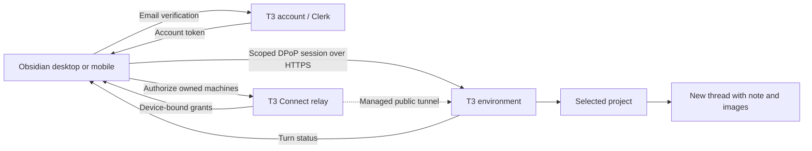

# Send to T3 Code

One Obsidian plugin for desktop and mobile. Chat from the command palette, send a Markdown note to a T3 project, or ask a thread to watch a note or folder. Linked folders choose the destination for notes below them. Manual sends preserve Markdown and embedded images.

## Incoming messages and senders

Steer callouts come from T3-confirmed incoming messages, including messages sent through fleet or T3's own composer. Local Obsidian sends retain their **You** label and only remove the unchanged originating selection after that exact message ID is confirmed. External inputs never remove editor text. Canonical display records and local selection receipts are separate, and message IDs deduplicate snapshots, live events, reloads and recovery.

The VPS fleet adapter attaches a `fleet-sender` context record after verifying the caller's local Codex session against its T3 thread. Valid records display **Agent · source title**; unattributed messages display **User**, including question answers without author evidence. T3's user role and message prose do not identify an author. This metadata is a trusted-client display convention, not a signed identity. Native T3 author headings remain a platform limitation. The laptop adapter has not been updated or verified for this change.

Live events retain the existing complete-paragraph boundary, including code-fence protection. The installed T3 detail feed omits start-request events, so incoming-message display uses the observed active response or its canonical lifecycle; it never treats that display association as an execution binding or a reason to adopt another turn. A recovered input without an observed boundary is marked **Recovered (paragraph position approximate)** because snapshots cannot reconstruct historical growth within one assistant message. Completed reply blocks retain their exact response binding. The existing opt-in `stream-thread` registration displays future turns in its chosen destinations; it now includes each turn's canonical initial input and sender label.

## Thread event subscriptions

The plugin notices changes; the subscribing T3 thread decides what to do. There is no workflow builder, stored task definition, setup thread, or new thread for each change. An agent registers a subscription through the same private command mailbox used for note sends. A subscription contains only a note/folder scope, selected change types, and the originating thread, project, and machine IDs.

With no enabled subscriptions, note monitoring and automatic activity logging are off. The command listener stays available so the next agent can register a subscription. Pausing or cancelling the last subscription stops recording; subscription records remain untouched; the activity log still resets daily. Old folder-workflow definitions are ignored and do not migrate or run. The retired menus, badges, settings, setup compiler, event journals, coordinator, and execution engine have been removed.

A subscription watches future saved Markdown changes from its registration. It supports creation, text modification, rename, deletion, or a named frontmatter property changing (optionally to an exact JSON value). Property values are compared by type, so `true` differs from `"true"`. Invalid YAML does not count as a property transition. Folder scopes may include subfolders; `/` watches the vault. Hidden paths and plugin log notes cannot be watched. Explicit note/folder scopes follow renames; a folder subscription continues watching its path after deletion, so a later recreated folder is covered.

Rapid changes to the same note are grouped after 1.5 seconds of quiet, with a maximum 30-second wait and the last 32 transitions retained. Notifications contain paths, change types, timestamps, text hashes, and bounded property before/after values. They do not archive full note bodies. The thread can read the current note itself. A busy thread's notification waits in the saved queue. The exact T3 message and command IDs and bytes are saved before dispatch and reused after interrupted delivery. Delivery never creates a new thread or changes the existing thread's model or permissions. `subscriptions` reports active scopes and pending deliveries, including retry errors.

Streamed plugin response blocks are excluded from text changes. Native completed output is excluded using immutable journaled materialization intents, including file events before final acknowledgement. Ordinary edits outside proven generated ranges are retained, and edits inside completed output count as user content. Ambiguous or changed ranges are not guessed. Marker examples inside code remain observable. Pre-native cleanup uses its exact saved prefix/body proof when available; older completions without such proof cannot be classified after their markers are gone. During a notification turn, other changes in that thread's subscribed scopes are also suppressed until it becomes idle and the plugin refreshes its baseline. This includes user edits in those scopes during that turn: the plugin cannot reliably distinguish their author. Ordinary user-started busy turns do **not** suppress queued events. Avoid subscribing threads to each other's output in a cycle; arbitrary agent-to-agent cycles and delayed Sync echoes cannot be identified perfectly.

Subscriptions and the delivery queue live in the vault project machine's private `.obsidian/t3-code/events/v1` store, outside Obsidian Sync. Every desktop's local agent mailbox forwards commands to that host through authenticated T3 file access. A separate host lock gives one Obsidian client capture and delivery authority; loss of the lock stops both. Keep Obsidian on the designated machine open and connected to the receiving thread's computer. Results identify the responsible host. An unavailable host never starts a local fallback watcher: retry the same request UUID. Changes from mobile or another computer are observed when Sync delivers them. No intermediate changes are reconstructed while the host is closed. On reopening or resuming, existing notes become a silent baseline; saved pending notifications resume. Updating, pausing, or cancelling cancels unsent notifications; an already accepted message cannot be recalled.

Changing the vault project machine stops the old watcher without automatically transferring its state. The designated host imports its own pre-2.28.1 local subscriptions once; legacy subscriptions registered on other desktops require explicit recreation after updating those clients.

### Register and manage subscriptions

Use the real originating T3 thread, project, and environment IDs; the plugin validates that the thread exists on that machine in that project. Do not substitute another thread or create a new one to receive each event.

```sh
python3 scripts/obsidian-command.py --vault /home/ubuntu/vaults/QLO2 \
  --request-id REQUEST_UUID subscribe \
  --scope Gym --scope-kind folder \
  --event property --property completed --equals true \
  --thread-id THREAD_ID --project-id PROJECT_ID --environment-id ENVIRONMENT_ID
```

The returned `subscriptionId` is the registration UUID. Omit the property options and use `--event modify` for any saved text change. Repeat `--event` to watch several of `create`, `modify`, `rename`, and `delete`; property filters are separate subscriptions. Use `--scope-kind note --scope 'Gym/Session.md'` for one note, or `--no-subfolders` for direct children only.

```sh
python3 scripts/obsidian-command.py --vault /home/ubuntu/vaults/QLO2 subscriptions
python3 scripts/obsidian-command.py --vault /home/ubuntu/vaults/QLO2 \
  update-subscription --subscription-id SUBSCRIPTION_UUID --event modify
python3 scripts/obsidian-command.py --vault /home/ubuntu/vaults/QLO2 \
  pause-subscription --subscription-id SUBSCRIPTION_UUID
python3 scripts/obsidian-command.py --vault /home/ubuntu/vaults/QLO2 \
  resume-subscription --subscription-id SUBSCRIPTION_UUID
python3 scripts/obsidian-command.py --vault /home/ubuntu/vaults/QLO2 \
  cancel-subscription --subscription-id SUBSCRIPTION_UUID
```

Updates may replace a scope or filter, but cannot change the receiving thread. After a timeout, reuse the exact request UUID and arguments. After a failed command, fix the cause and use `--retry` with the same UUID and input. A fresh `subscriptions` command uses a fresh request UUID to get the current state. The agent instructions are maintained in [the Obsidian T3 skill](docs/obsidian-t3-SKILL.md).

## Setup: desktop and mobile

1. Install and run T3 Code on your computers. Sign in to the same T3 account and enable **T3 Connect** on each destination. T3 supplies the public HTTPS connection; no Tailscale or plugin companion is required. See [T3 remote access](https://github.com/pingdotgg/t3code/blob/main/docs/user/remote-access.md).
2. Install `main.js` and `manifest.json` in `<vault>/.obsidian/plugins/send-to-t3-code/` and enable the plugin.
3. In **Settings → Send to T3 Code**, keep **T3 Connect (recommended)** selected. Enter your T3 account email and click **Send sign-in code**.
4. Enter the six-digit code from T3’s email and click **Verify and connect**. The plugin discovers your account’s computers, authorizes each online connection and scans its projects automatically. No terminal commands, machine URLs, pairing links or per-machine codes are needed.
5. Every discovered project appears automatically in the folder and send project menus. Their names include the destination computer. On mobile, use the note menu → **Open in T3 Code**, or the command palette’s **Send to T3 Code** row.

Sign in once on each device. Connection names and folder links sync; credentials and derived project snapshots stay on that device. Cached projects appear immediately, including offline machines, and are labelled when their availability is unverified or offline. Sending still requires an authenticated, reachable destination. Projects refresh automatically on startup, sign-in/pairing, changed synced connections, resume/network reconnection and while Obsidian is active. All registered account machines and saved connections are refreshed with up to three concurrent machine reads. One offline machine cannot remove another machine’s projects. Failed reads preserve that machine’s last snapshot; a successful empty read clears it. Retries back off from 15 seconds to five minutes. Healthy catalogs refresh about every five minutes. **Refresh connections** can also retry immediately. Discovery never sends or replays a note.

Project snapshots use vault/device/account-scoped IndexedDB storage, seeded from legacy project arrays when no local cache exists. Fingerprints suppress unchanged local writes and project-list notifications; they do not avoid network requests because T3 provides no conditional project-read endpoint. Project selection toggles and the manual project scanning menu have been removed. Folder routing, remembered threads and saved retries keep their exact machine/project identities.

This is an independent integration with T3’s existing native authentication and relay APIs. Email verification uses T3’s Clerk native frontend API, enabled by T3, and its `t3-relay` token template. The relay accepts that credential and issues device-bound connection grants. The plugin requests only environment thread read/operate scopes. It does not read installed T3 credentials or browser cookies, impersonate an existing device session, register a replacement `t3code://` handler, or need access to your email inbox. It does not collect your T3 password or create a new T3 account.

Account/session tokens stay in device-local, vault-specific Obsidian storage and are not OS-keychain encrypted. The device’s non-extractable DPoP signing key stays in local IndexedDB. Neither is written to the synced vault. Email verification codes are not retained. **Sign out** removes account credentials and account-managed environment sessions on this device, and asks T3 to revoke this sign-in session. Independently paired manual connections are retained. If revocation cannot reach T3, the plugin reports that local sign-out succeeded and directs you to T3’s account controls for remote revocation. A cancelled or expired sign-in does not restore account access later.

Sources: [T3 relay authorization](https://github.com/pingdotgg/t3code/blob/main/infra/relay/src/http/Api.ts), [T3 managed account authentication](https://github.com/pingdotgg/t3code/blob/main/apps/web/src/cloud/managedAuth.tsx), [Clerk email-code sign-in](https://clerk.com/docs/guides/development/custom-flows/authentication/email-sms-otp), and [Clerk native API behavior](https://clerk.com/docs/guides/development/errors/frontend-api).

### Advanced: manual pairing

After account connection finishes, existing manual pairings still work. Expand **Advanced: manual pairing** to use a known HTTPS environment address and a fresh T3 pairing code or link. A hosted `https://app.t3.codes/pair?host=…#token=…` link is accepted. Manual pairing is available without account sign-in. Each device pairs separately; manual sessions require pairing again after their displayed expiry. Re-pairing preserves folder routing and pending requests.

T3’s Connections page currently hides its pairing controls when Network access and Tailscale HTTPS are both off, even when T3 Connect is enabled. In that case the official `t3 auth pairing create --ttl 10m --label Obsidian --json` command on the destination can issue a code without changing its network settings. This command is **not needed for the recommended account setup**.

Manual pairing exchanges a one-time code for a scoped bearer session. The code is discarded, and the session remains only on this device. **Forget pairing** removes the local credential; revoke its client session in T3 Settings → Connections to revoke server access. Remote connections require HTTPS and refuse redirects; HTTP is allowed only for loopback testing.

### Advanced: this computer only

Desktop users can choose **This computer only (advanced)** to use local T3 without account sign-in. Install T3 and its matching official CLI. The plugin discovers the CLI in standard locations or PATH; executable and data-directory overrides are available if needed. Registered local projects appear automatically and refresh in the background. The CLI issues five-minute sessions for T3’s authenticated loopback API, which the plugin revokes after each operation. No shell interpolation, Python or Fleet adapter is used. This option is unavailable on mobile.

The destination must remain online. There is no offline queue or automatic resend. An interrupted send is saved for **manual Retry** with its exact original commands, preventing duplicate threads after a lost response. Completion monitoring uses the same connection while Obsidian is active.

New threads use the selected machine's T3 model defaults: an explicit project override takes precedence over the environment default. Configured model options, including reasoning effort, are preserved; previous threads do not supply the model or reasoning settings. If T3 is set to automatic selection, the plugin uses an enabled provider's advertised default model. New threads always use approval-required runtime permissions; they never inherit permissions from previous threads in any project. Existing-thread sends retain that conversation's model and permissions. Saved retries replay their original model and commands even if defaults have since changed.

## What belongs to T3, and what belongs to this plugin?

| Component | Owner |
| --- | --- |
| Projects, threads, model execution, image attachments and turn status | T3 Code |
| Pairing codes, scoped sessions and orchestration HTTP endpoints | T3 Code |
| T3 Connect account, native email verification, managed HTTPS tunnel, discovery and device-bound grants | T3 Code |
| Obsidian sign-in UI, automatic connection/renewal client, project menu, image extraction and completion actions | This plugin |
| Old HTTPS companion and its SSH/Python forwarding | Custom component removed in 2.1 |
| Fleet adapter and persistent delivery queue | Not used by this plugin |



Account connections and manual pairing use T3's existing protocols, not an official Obsidian SDK or a guarantee of long-term API stability. Sources: [T3 auth endpoints](https://github.com/pingdotgg/t3code/blob/main/apps/server/src/auth/http.ts), [remote client implementation](https://github.com/pingdotgg/t3code/blob/main/packages/client-runtime/src/authorization/remote.ts), and [pairing URL construction](https://github.com/pingdotgg/t3code/blob/main/apps/web/src/components/settings/pairingUrls.ts).

## Upgrade

Install the newest release and reload the plugin on each device after Sync finishes. Existing manual connections, project selections, and folder links remain. Previous v1 workflow and tag trigger definitions are no longer loaded or shown. Each device clearly requires its own email verification before synced projects and folder links become visible. The old HTTPS companion mode and bundled Python/SSH code are removed. Devices previously using that mode now open **T3 Connect** and can use the account setup above. Old service URLs, keys and remote project catalogs are removed from the active settings. Local desktop settings and direct connections remain available.

Old unconfirmed sends remain visible for review but cannot be retried through the removed mode. Check the original thread in T3 before creating another send, since the earlier request may have started. Discard only removes the local retry record. Old companion completion jobs keep their notes and stop monitoring. Direct/local completion monitoring continues. No request is automatically rerouted or sent during migration.

The obsolete companion service is no longer part of the plugin. Its operator can stop/remove it after upgrading their clients. Historical state backups may be retained privately, but neither companion nor queue files are read by this plugin.

## Command palette

Open Obsidian’s command palette (Ctrl/⌘ + P, or your configured mobile swipe-down action). Its first T3 Code row changes with the editor selection and palette input:

For a keyboard shortcut, assign **Send to T3 Code: Send to T3 Code** under **Settings → Hotkeys**. One command handles both modes: with no selected text it sends the full note; with selected text it asks about that selection. It opens the same project/thread chooser and follows the same editor streaming switch. It ignores saved command-palette drafts. No default shortcut is assigned. The command is available in Markdown editors, including mobile with a keyboard, and remains available in the ordinary palette if the dynamic T3 row is unavailable.

| Selection | Typed input | First row | Sent to T3 |
| --- | --- | --- | --- |
| None | None | **Send to T3 Code** | Full Markdown note and embedded images |
| Text | None | **Ask T3 Code** | Selected text, its embedded images, and note location |
| None | Text | **T3 Code: “…”** | Typed question and note location |
| Text | Text | **Ask T3 Code: “…”** | Selected text, its embedded images, typed question, and note location |

The palette keeps one device-local draft. A confirmed question clears it. Sending uses the same note/image packaging as **Open in T3 Code** in the Files sidebar; asking does not copy the full note. All send and ask dialogs use the same compact layout. **Previous thread** defaults to the last thread used for this note; **New thread** and **Existing thread…** offer alternatives. The buttons wrap to fit narrow screens. Pressing Enter chooses the purple default button. Click the project-name button to select a project for this send. Its tooltip includes the source note path. For notes without an explicit parent-folder link, the default is **New project: <containing folder name>**, followed by **Vault project: <vault project name>** in the project selector. Opening or cancelling the dialog does not create a project or link. Choosing the vault project leaves the folder unlinked. A manual message ends with **Sent from Obsidian.**, the vault name, and the destination note path. No vault-relative path line is sent.

Click **Overrides** next to the project button to choose settings for one new job: **Stream replies into the editor** (On / Off), **Intermediate agent responses** (Remove / Keep / Collapse), and **Final answer format** (Current formatting / Raw Markdown). Each control starts at **Use default**, showing your current setting. **Apply** saves the dialog draft, **Cancel** discards child-dialog edits, and **Reset overrides** restores inheritance. The button counts explicit choices, including choices equal to the current default. Turning streaming Off disables the dependent controls while keeping their draft values. Global settings remain unchanged.

The draft survives project changes, returning from the existing-thread picker, and errors before a job is saved. Closing the send dialog discards it; the next send starts from defaults. Effective choices freeze when you confirm the destination (when selecting a thread for **Existing thread…**) and are saved before dispatch. Retry, reload, handoff, and every mirror of that response use the saved choices. **Send to running thread** keeps the running response’s established streaming and rendering policy and existing block; **New thread** uses the overrides for a fresh response.

The nearest explicitly linked folder supplies the destination, including for notes in subfolders. An unlinked note inside a folder defaults to **New project**. Confirming the send opens the workspace picker: choose a machine and an existing workspace outside the Obsidian vault. The project name defaults to the folder name, and an already registered workspace project is reused. Cancelling creates no thread or folder link. A confirmed send saves the external folder link; failed delivery retains the intended link with the saved retry. Existing note-thread history continues to supply the previous-thread default. Root-level notes and chat with no Markdown note open use the vault-root link. If that association is missing or its project is no longer discovered, mobile opens **Connect vault** and keeps the original prompt ready. On desktop, connected machines offer the same chooser with **This computer** as an additional option; without remote connections, the plugin can still discover or create the local vault project automatically using the official T3 CLI.

Manage the default under **Settings → Send to T3 Code → Orchestration → Vault project machine → Connect vault / Change machine**. Choose any machine discovered through your T3 account or manual pairing, then select **Find vault**. The plugin checks remembered locations and registered projects for this vault's synced identity. Select a matching folder, or use the remote folder browser to find its existing synced copy. **Use this folder** verifies the identity, reuses or creates a project on that machine, saves the association, and resumes the original chat action. Cancelling setup leaves the prompt open. An offline machine leaves setup open for retry or another choice.

Vault identity, known machine locations, and the chosen root association sync in plugin settings; session credentials and unfinished project-registration commands remain device-local. Enable community-plugin settings in Obsidian Sync on both devices. A matching name alone never connects a folder: different local vault names are fine, but the synced identity must match. Thread-only sends can use headless Sync without desktop Obsidian. Streaming replies into notes requires Obsidian with this plugin running on the vault project machine; the destination note can remain closed. The selected computer must already have a synced copy; this feature neither provisions a new Sync account nor uploads a replacement vault.

Newly connected remote vaults check that the referenced note appears in the destination folder before sending, briefly waiting for Obsidian Sync if it is missing. This checks file presence, not whether every edit or attachment has finished syncing. Local desktop sends use the absolute note path. Self-linked remote folders use their project root, while other remote folder links use a root link on the same connection as the destination-vault mapping. If no safe destination path can be found, the footer says **(unmapped on destination)** rather than inventing a filesystem path.

The live row uses isolated, version-checked internal command-palette methods because Obsidian does not expose a public dynamic-result API; keep the core Command palette plugin enabled. The note context is captured when the destination dialog opens. Switching notes while choosing a thread does not change that context.

Questions retain the optional wait instruction, 120,000-character limit (including note context), and manual retry handling. They never enroll the note for archive/delete cleanup. An unconfirmed send must be retried through **Unconfirmed requests → Retry**, which preserves the original prompt, note path, destination, and command IDs.

## Inline responses

Under **Settings → Send to T3 Code → Inline responses**, **Stream replies into the editor** is on by default for all manual Send and Ask actions. With an updated host, the sending device displays new replies locally while the **Vault project machine** saves their final result. Older hosts retain exclusive device writer ownership, even when a folder link sends the T3 thread to a different machine. Turning streaming off keeps answers in T3 threads.

Manually sending a note with **Open in T3 Code** or palette **Send to T3 Code** appends a streamed reply at the end of that note. A typed palette question also appends its reply at the end. The plugin opens the note in a Markdown tab if needed. A full-note send captures its content before inserting the response and sends that content and its images to T3. A streamed note stays in place even if archive or delete is selected under **When task completes**. Changing the switch affects new sends; an already active response continues to completion or until stopped.

## Ask T3 inline

While a response is running, place the cursor inside its block and use **Ask T3 Code** or type a question in the command palette and choose **Send to running thread**. For a selection elsewhere in the note, use **Ask T3 in this response** to explicitly choose the destination block. The plugin sends it to that response’s existing T3 thread and keeps writing in the same response block. Your input appears as a neutral indented **You** quote between the agent’s paragraphs. Selected text outside tracked responses moves from its original location only after T3 confirms the message; typed palette input is inserted directly. If the selection changed in the meantime, its edited source text is preserved. Selections inside a tracked response, or spanning its boundary, are sent as captured context and stay in their original response. Streaming can continue while the destination chooser is open; the message uses the text you selected.

Steered responses retain the assistant paragraphs around your messages, including when **Intermediate agent responses** is set to Remove. Input positions, exact message IDs, and the transcript survive reconnects, plugin reloads, and writer handoffs. Any authenticated device can send without taking ownership of the writer. Active response contents are replaced by authoritative T3 output, including after Sync changes. Saved delivery failures use **Unconfirmed requests → Retry** with the original IDs; the plugin never automatically resends input. If the original turn finishes after steering is reserved, a resulting new turn is explicitly attached to the same response. If the response has already finalized or is paused before reservation, the send is refused. Pending approvals and structured questions must be answered before ordinary steering.

Select text in a Markdown editor and choose **Ask T3 Code** from the editor menu, or use the palette’s **Ask T3 Code** row. Choose **New thread** or **Existing thread…**. The plugin sends the selection, its embedded images, and destination note path to T3, then inserts a tracked response below the selected line. Add text in the palette to send a specific question about the selection. Typed palette questions appear immediately at the top of the response block in the same neutral **You** quote as steering messages. Only the typed question is displayed; selected context stays in its original location. The quote remains with the final answer, independently of the intermediate-response mode, and survives retries, reloads, and writer handoffs. The response shows **Thread name · Working** from initial submission through streaming, without a separate sending label. The loading spinner is visible from the initial response insertion and continues animating while the reply streams. A matching spinner row at the bottom shows the exact response turn’s current activity, such as **Reading file**, **Running npm test**, or **Thinking**. **Working** is the fallback when T3 has no specific live activity or the connection is recovering. Tool output stays in T3; approval and question prompts still appear in the note and through an Obsidian notice. When the turn completes, the plugin replaces progress text with only the final answer by default. Choose **Keep** under **Intermediate agent responses** to retain the agent’s progress paragraphs alongside the final answer, or **Collapse** to fold progress under the thread/status header. This choice applies to new responses and stays with each response through reloads and device handoffs; routine tool activity is still omitted. Status indicators disappear on completion in Remove and Keep; Collapse retains the completed header and elapsed duration. The plugin owns the note insertion. Confirmed steering moves the unchanged selected text into its **You** quote atomically with the response update; interrupted writes retry removal, and delayed synced saves cannot leave that same anchored text duplicated outside the response.

When T3 asks for input, the question text and option descriptions appear beneath the streamed progress in the same purple quote. **Answer** opens an Obsidian dialog in Live Preview or Reading view; **Answer T3 question…** also appears in the editor menu and command palette. The dialog supports single choice, multiple choice, free text, and several questions in one request. Incoming questions never open it automatically. Streaming refreshes preserve the draft, focus, and text selection. Closing the dialog saves the draft without answering or dismissing. Only **Submit answer** sends a response; a preselected choice alone never sends.

The Files explorer shows a small spinner beside notes with active T3 response bindings. A green light means all tracked replies in that note completed; a blue light means a reply still needs input, including an async question after its turn has finished. Active work and pending input can appear together when several threads or mirrored replies share a note. Failed, paused, interrupted and unresolved replies never count as completed. Indicators recover from the coordinator’s existing response records after reload and follow note/folder renames and deletion. Linked folders use a compact link icon with the full project name in its tooltip and accessible label. When **Folder notes** is enabled, folders marked by that plugin also receive their folder note’s indicators, using its naming, storage-location and file-type settings; ordinary folders do not inherit all descendants’ activity. This optional integration does not change Folder notes or note contents. Reduced-motion preferences keep the activity ring static.

Blocking questions wait for an answer. Async questions show **Question pending** and remain answerable after the turn finishes. The final answer stays visible without a loading indicator, while hidden response markers keep the writer watching. Your confirmed answer appears as a neutral **You** quote inside the same response, just like a steering message. Once a late answer is accepted, the thread title and animated **Working** indicator return beneath the **You** quote until the follow-up finishes. Answering automatically resumes the same T3 thread and streams its follow-up into the same response in the note, including after a plugin reload or writer handoff. The writer follows the exact question-answer message, so unrelated turns cannot replace the reply. Tracking markers are removed after all pending questions are answered or dismissed and the attached turns finish. Only async questions offer **Dismiss**, which closes the request without messaging the agent. Once T3 confirms resolution, the answer dialog closes with a brief notice; a dispatch acknowledgement alone does not close it. The note stays ordinary readable Markdown. Once answered, the controls and question tracking comments disappear; the completed question text is preserved.

Continuing a failed response keeps its earlier progress visible alongside the explicitly attached new turn. With **Intermediate agent responses** set to Keep, that entire transcript remains after completion. Steering uses the same transcript, so adding a steering message or answering a question does not swap the visible history. Existing checkpoints from older versions recover their adopted continuation turn when the writer resumes.

Any device viewing the synced question can answer using its own authenticated connection to the original T3 machine, regardless of which device owns streaming. The plugin refreshes authoritative request state before submitting, preserves native question IDs and option values, and waits for T3’s resolution before clearing controls. An answer in T3 or another Obsidian client clears them here too. Drafts and exact pending commands remain device-local. If the connection drops during submission, reopen **Answer** and use **Retry saved answer** to retry the original command safely. Provider failures retain the draft. Existing local and hosted responses use the same question model.

With editor streaming off, the same question and note path are sent, and T3 answers in its thread without the plugin adding a response to the note. Send instructions ask T3 to answer in its thread and, when streaming, explain that the plugin inserts the reply. They do not prohibit note edits requested by the user.

On mobile, selecting text in the Markdown editor shows a small **Ask T3 Code** button above the selection. Tap it to open the same thread chooser; no mobile toolbar setup is needed. The button disappears when the selection is cleared or another note becomes active. The iOS Cut/Copy/Paste menu itself cannot host plugin actions.

The response is surrounded by small HTML comment markers so it can be found after edits elsewhere in the note, file/view switches, or a plugin reload. Obsidian hides these tracking lines in its editor; they remain in the raw Markdown for safe updates and may be visible in other text editors. The owning device replaces only the marked response and preserves surrounding text. It remembers generated versions so an older generated block arriving through Sync can catch up. While tracked, response contents belong to T3: changes inside an intact response block are overwritten on the next update, including Sync duplications. Removing or damaging the tracking boundaries stops insertion into that destination; the answer remains available in T3. Replies update the live editor when open, or the vault file when closed. Each write rechecks ownership and current note contents. Replies started under the previous host-only implementation still finish on their original host; older device-local replies also overwrite changed active contents. Prose remains in a blockquote; headings, top-level tables and fenced code blocks render outside it so they work in Live Preview. A partial table moves out of the quote when its delimiter row arrives, and an open code fence is temporarily closed while streaming. Selecting text inside a fenced block places the response after the closing fence; an unclosed fence must be closed first.

Disconnected responses reconnect automatically once their T3 connection and vault host are available again. The saved user-message ID keeps recovery tied to the original response even if you continue chatting in T3 before Obsidian reconnects. When the original turn has fallen outside the recent 20-turn polling window, the plugin reads the complete canonical history and recovers only an unambiguous original turn. Completed historical responses use their durable completion checkpoint and final message ID. Projects without Git checkpoints can also finish recovery when the complete canonical transcript shows finalized assistant messages before a newer user-anchored turn. A newer running turn does not leave an older answer stuck on Working. Recovery uses the existing request and response block; it never sends another prompt. Ambiguous history remains tracked for a later retry, and edits inside the response remain protected.

If T3 fails a turn, the tracked response shows the reason reported by T3, including a usage-limit message when T3 provides one. It remains recoverable. In the editor menu, **Continue T3 response** sends exactly `Continue.` as one new turn in the same thread and streams its answer into the existing response with one click. **Attach latest T3 continuation** binds a newer turn already started in T3, after checking that its user message belongs to the same thread. If the note moved, either action can recover the response when its original path is gone and its response boundaries are intact. Both actions replace changed contents inside that tracked block. A lost send acknowledgement still uses **Unconfirmed requests → Retry** with the original request ID; it does not create another continuation. If T3 resumes the original turn after a server restart, that turn can finish in place without a new message. The plugin does not repeatedly send requests while a provider limit is active.

At turn completion, the owning device imports local image and file references from the retained assistant Markdown (the final answer by default, plus intermediate responses when enabled). It uses T3's signed file URL for previewable files and its project reader for text files, saves deterministic copies under `T3 Code Attachments/<response-id>/`, and replaces each reference with an Obsidian link at its original position. Existing vault files are linked directly. External web links and examples inside code remain unchanged. If a file cannot be imported, the final answer still completes, keeps the original link, and shows a bounded import notice. Attach the same exact response again to retry imports into a new independent destination; completed text is not rewritten. Downloads have a 30-second timeout. Other remote binary file types need an upstream file download route before they can be imported.

Streamed updates preserve the editor's reading position rather than scrolling to the cursor. An active response offers **Stop T3 response** in the editor menu, which immediately finishes the visible response as ordinary Markdown: the received text is preserved, the working indicator and tracking tags are removed, and the Stop action disappears. Cleanup works even when T3 is unreachable or the stream state is missing, and Stop is also available on failed responses alongside continuation controls. Pending question prompts are preserved as text while their response controls are removed. Interrupting the bound T3 turn happens independently; stop requests that this device cannot deliver are retried while Obsidian is open and after reopening. Remote interruption remains best effort. Late stream events cannot resume a stopped response. Command approval prompts show small **Approve** and **Deny** buttons on the **Action needed** line in Live Preview and Reading view, with the requested command beneath it when T3 supplies it. Approve allows this request once; Deny rejects it. Any authenticated device connected to the original thread machine can respond. Buttons remain disabled while T3 applies the decision and disappear when the request resolves, including when answered from another device. A lost connection offers **Retry approve** or **Retry deny**, replaying the exact saved decision; the plugin never automatically submits or retries an approval. Other approval types remain in the T3 app. Stopping a response removes its approval controls while preserving the command text. Questions can be answered directly in Obsidian as described below. Full reasoning traces and tool payloads are not copied into the note. Before dispatch, the sending device registers its response through the existing authenticated T3 connection. This does not wait for the note or response marker to sync to the VPS. The device receives T3 updates directly and writes the actual Markdown locally; there is no separate response display.

Ownership lasts 15 seconds and renews with a heartbeat every 3 seconds. Only missed heartbeats allow another connected Obsidian instance to take over. Hiding the app, switching notes, closing the plugin, or a visibility notification does not release ownership. If mobile timers keep running in the background, the phone keeps ownership. If they stop, another instance with the synced response marker can claim after expiry. Clients with the note open get a short head start over closed-note fallback writers. A returning sender must acquire a fresh grant before writing again. When no eligible client is active, the T3 run continues and its response catches up later. The device that owns the reply gets direct updates; other devices still receive note changes through Sync.

For threads on a connected remote computer, the writing device does not need its own T3 Code app or local server running. Obsidian and this plugin must remain active, and the thread machine and vault project coordinator must remain reachable. Local-only threads still require their local T3 server. These requirements also apply to question controls and continuation actions.

The vault project machine must keep Obsidian and this plugin running to grant ownership and accept heartbeats. It stores requests, ownership epochs, and known response versions under `.obsidian/t3-code/inline/v1/` (or the configured settings directory). Clients reach these files directly through T3; they contain no credentials and are not carried through Sync. A filesystem lock admits one coordinator, which serializes claims. Each writer checks a conservative local deadline immediately before note mutations, and checkpoints generated versions before inserting them. A completed editor reply stays recoverable until Obsidian has saved its final Markdown to disk. Independent jobs and heartbeats keep slow threads or downloads from blocking other notes. Unchanged progress does not rewrite the note. A lost coordinator connection stops writes once the grant expires; it cannot authorize a second writer offline.

Native responses use a fixed host for final-save coordination; they do not elect a device writer. Interactive registration and recovery commands take priority over bounded batches of legacy claims. The authority builds its lease indexes once on startup, and denied legacy claims wait for the blocking grant or back off instead of retrying on every heartbeat. Historical reply cleanup is bounded maintenance. Completed journal observation also runs in rotating batches after active responses. Verified immutable journal prefixes avoid repeated body reads and hashing while file identity, nanosecond change times, chain extensions and caller isolation are checked; changed or missing verified history fails closed. Registration timeout remains a failed send, requiring explicit exact-ID recovery; successful recovery does not make that timeout acceptable live-smoke evidence.

The send modal closes immediately while delivery continues in the background. Validation failures reopen the draft; saved delivery failures show a notice without taking over the editor. If registration fails, the request stays in **Unconfirmed requests** for explicit retry with the same IDs. Install/reload the updated plugin on the vault project machine and each device that should participate. Changing the default machine affects new jobs; existing jobs retain their original coordinator.

On desktop, reply registration, writer heartbeats, and the coordinator lock use Node timers so backgrounding Obsidian does not delay delivery or expire healthy ownership. Mobile writers still hand off when their app is suspended.

The editor menu can request **Stop T3 response** from a synced device. Even an orphaned response block can be cleaned up on the current device. Remote interruption of an older device-local job requires its original device and connection. The agent owns the contents of an active response block until it finishes. Changed text inside intact tracking boundaries is overwritten with the latest T3 output; changes outside the block are preserved. Previously paused bindings with intact markers can recover after reload or writer takeover. Removing or damaging a response boundary prevents replacement; restoring the boundaries lets the open editor catch up. Completed, finalized responses remain editable and are no longer rewritten. Remove abandoned response markers/blocks when they are no longer needed; independent responses can coexist.

## Orchestration

Settings → Send to T3 Code → **Orchestration → Wait for other threads** is off by default. Enable it to prepend this instruction to each new note or chat prompt:

> Before starting work on the task below, wait for all other active T3 Code threads in this project to finish. Exclude this thread and threads in other projects. Check their status periodically, and begin work only when no other threads in this project are active. If you cannot check thread status, ask the user before proceeding.

The setting persists per vault. This is an instruction to the receiving agent; the plugin does not enforce a project lock or wait before delivery. There is no delivery queue. It requires the agent to be able to check T3 thread status. The remaining note content and image references are unchanged. Retries use the originally saved prompt, even if this setting changes afterward.

## Folder links

Right-click a folder and choose **Link to T3 Code → Link to <project>**. Confirm the link in the dialog. Links appear under **Settings → Send to T3 Code → Linked folders** and route manual chat and note sends. Saving a link alone does not send notes.

**Create T3 project…** replaces Link to self on desktop and mobile. Choose a machine, browse to an existing workspace folder (or type its path), and select **Create and link**. The project name defaults to the Obsidian folder name. The plugin reuses any T3 project already registered at that location and saves the folder link. Browsing or cancelling does not create a project or change the link. The workspace must be outside the Obsidian vault. Automatic **New project** sends from unlinked folders use this same picker. Existing links and remembered threads are not migrated.

Shared preferences use a field-level three-way merge against the last adopted snapshot. Distinct nested edits merge; simultaneous changes to the same field prefer the current disk value. Arrays are atomic, while folder links, note history and delivery relations use their own merge protocols. Project selection toggles are retired. Folder links sync with the vault. T3 credentials remain device-local. Each explicitly linked folder shows the **T3 logo followed by its linked project name** beside the folder name in the Files explorer on desktop and mobile. Other descendants remain unmarked. Long project names truncate to fit the sidebar, with the full name available in the tooltip and accessibility label. The indicator updates when links are added, removed, renamed, or synced.

### Sending notes into linked projects

**Open in T3 Code** opens the same compact project/thread destination dialog on desktop and mobile, with **New thread** and **Existing thread…** choices. The existing-thread option loads a searchable list of that project’s unarchived threads, newest first, with each thread labelled **Active** or **Idle**. Nested links take precedence. The command palette uses the same compact dialog for every note. Browsing existing threads for a new folder project does not create it; if no project exists yet, use New thread. A missing linked project reports an error instead of rerouting the note.

### Previous thread

After every confirmed manual Send or Ask, the plugin remembers that thread as the note’s default for its next send. **Previous thread** means the last thread used from this note. This happens automatically, including when choosing a new or existing thread; there is no remembering toggle in the dialog or settings. An unconfirmed send does not change the default. Use **Existing thread…** to choose another conversation from the selected project.

Thread history syncs in plugin settings and contains note paths, project destinations, and thread IDs, but no note body or credentials. Renaming a note moves its history; deleting it retires the records. History mutation revisions advance monotonically independently of last-used ordering, including move-back and clock rollback. The previous thread must still exist in its original T3 project. If that project is unavailable, the plugin reports the problem instead of rerouting the send. Notes are kept when a manual send completes.

Existing history and requests saved under the former note-thread-link terminology remain usable. Older sends without a unique recorded note path cannot be identified reliably by title alone. The plugin recovers a remembered destination from a confirmed completion job when its note and project still exist. Folder linking remains separate and continues to supply the default project.

Both choices send the full Markdown and embedded images. Existing-thread sends preserve its model, runtime permissions and interaction mode. An idle thread starts another turn; a running thread receives input through T3’s steering behavior. Resolve pending approvals or structured input in T3 before sending another note. Retries reuse the original thread and message IDs without creating a new thread. Every confirmed manual note send keeps the note and supersedes any older cleanup job for it.

**Settings → Send to T3 Code → Threads → Settle completed threads** is on by default. After a successful Obsidian turn, the plugin moves its T3 thread from the active list to the Settled shelf. A streamed answer must finish saving into its note first. Checks run every 30 seconds while the sending Obsidian client is open and resume after a restart. Pending approval, requested input, live background work, failed or interrupted turns, and turns superseded by later activity do not trigger settlement. Only threads sent by this plugin are affected. A later send to the same settled thread automatically wakes it and preserves the note’s remembered destination. Turning the setting off cancels pending settle checks; later sends remain active. Settling does not archive or delete the thread.

## When task completes

Manual sends always keep their note because each confirmed thread becomes its next default destination. The **Orchestration → Legacy cleanup defaults** settings remain available for previously queued cleanup jobs: **Keep note** (default), **Archive note**, or **Delete note (vault trash)**. Archive has a configurable vault-relative folder, defaulting to `Archive/T3 Code`; it preserves the note’s original subfolders and adds a numeric suffix if a destination already exists. Delete moves only the Markdown note to this vault’s `.trash`; embedded image files remain in place.

The plugin polls the destination T3 environment every 30 seconds while Obsidian is active. Mobile can suspend the app; checks resume when reopened. The completion signal is the original sent turn reporting `completed`, with its session idle (ready or stopped), no pending approval/input, and its original user message and final assistant message verified. This is a T3 lifecycle signal, not a judgment that the answer fully solved the task. Failed/interrupted turns and conversations that have advanced to additional turns keep the note.

The completion action and note fingerprint are saved when sending. Later setting changes affect new sends only; retries preserve the original action. Monitoring resumes after Obsidian restarts and retries connection errors. **Task completion monitoring** shows status and offers **Check now**, **Stop monitoring**, and **Dismiss**. Starting a newer send for the same note supersedes its previous cleanup action once that send is confirmed.

Notes edited, replaced, renamed, or left with unsaved editor changes are kept. Archive/delete runs in the sending Obsidian vault, including when the T3 thread runs on another computer. Existing notes and previously sent threads are not automatically enrolled.

The **Final answer format** setting under **Inline responses** defaults to **Current formatting**. **Raw Markdown** inserts only each verified completed final answer without added blockquote prefixes; while a turn is running, its paragraphs retain current formatting. Intermediate responses still follow **Remove / Keep / Collapse**, and questions, steering controls, status, timers, and tool activity keep their existing presentation. Both formats share image/file imports and literal-HTML protection. The choice is saved per response, including independent destination bindings, and survives reloads, writer takeover, continuations, and question answers. Setting changes affect new responses. Raw-mode responses require an updated writer; older clients cannot take them over.

## Embedded images

Full-note sends and Ask T3 questions use the same image packaging. Only images embedded in the selected passage or question are attached; unselected note content is not sent.

Supported embeds: `![[image.png]]`, `![[folder/image.png|300]]`, ``, reference-style Markdown images, HTTPS image URLs, and base64 image data URLs. Local links use Obsidian’s resolver relative to the source note, including attachment folders and percent-encoded paths. Images inside code blocks, inline code, frontmatter, and escaped wiki embeds are ignored.

PNG, JPEG, GIF, and WebP bytes are uploaded through T3’s native attachment API. Each original embed is replaced by a native `t3-context://` reference, so the image stays at that point in the message. Repeated images reuse one attachment; all other Markdown is unchanged. Neither the note nor its images are moved or modified in the vault. HTTPS downloads use Obsidian’s `requestUrl` with no access key or authorization headers added. Mobile downloads are buffered by Obsidian before the byte limit can be checked; for large remote images, download a resized copy into the vault first.

Limits: 8 distinct images, 10 MiB per image, 20 MiB combined, and T3’s 120,000-character prompt limit. Missing images, failed downloads, HTML `` embeds, unsupported formats such as SVG/HEIC, and limit violations stop the send with an error instead of silently omitting images. Convert unsupported formats to PNG/JPEG first. Non-image wiki transclusions (notes/PDF/audio) remain as Markdown and are not expanded. Image-only notes work.

The plugin includes image support. The selected T3 model/provider must accept image input. Direct pairing is verified against T3 0.0.43-nightly.20260917.1866; local integration was also tested against 0.0.43-nightly.20260916.1811; recheck compatibility after T3 upgrades.

## Empty states and recovery

Empty notes are rejected without creating a thread. Unlinked note sends offer a new containing-folder project and the vault project even when no projects are selected in settings. Linked-folder sends and palette chat use their folder/root association independently of the project-menu selection toggles. Failed scans report the error and preserve the last discovered list; unavailable selections are retained for later rediscovery. Sending to a removed project reports an error without scheduling delivery.

A request is saved before dispatch. During sending, additional sends are disabled. If a response is lost or fails, **Unconfirmed requests** in settings offers **Retry** using the exact original content, connection, and request ID. Do this instead of clicking New thread again, which intentionally creates a separate request. **Discard** removes only saved local retry data; it does not cancel or delete any T3 thread. Restarting Obsidian does not resend anything automatically.

Pending requests store the full note and base64 image bytes in local IndexedDB until confirmed/discarded. Direct mode stores the complete immutable commands in device-local IndexedDB before dispatch, without a server-side plugin journal. Local desktop integration keeps a private request journal under the T3 data directory (`send-to-t3-code/desktop`). Journals retain prompt/image bytes to retry exactly; they contain no session credentials. In local mode, T3 credentials are issued through its official CLI and revoked after use. Direct pairing sessions stay in device-local app storage. Official CLI output is bounded and each CLI operation times out after 45 seconds. Note contents and image payloads travel in authenticated HTTP request bodies, never shell commands or CLI arguments.

## Agent folder routing commands

Agents can inspect, link, deliberately relink, and unlink existing vault folders through the same private command mailbox used for note sends:

```bash
python3 scripts/obsidian-command.py --vault /home/ubuntu/vaults/QLO2 \
  --request-id INSPECTION_UUID inspect-folder 'Projects/Side/handoff'
python3 scripts/obsidian-command.py --vault /home/ubuntu/vaults/QLO2 \
  --request-id LINK_UUID link-folder 'Projects/Side/handoff' \
  --project-id PROJECT_ID --connection-id CONNECTION_ID --environment-id ENVIRONMENT_ID
python3 scripts/obsidian-command.py --vault /home/ubuntu/vaults/QLO2 \
  --request-id UNLINK_UUID unlink-folder 'Projects/Side/handoff'
```

Use verified project and machine IDs. The connection ID is an exact configured paired connection or `local` for this desktop. Linking verifies the authenticated machine and live project catalog, then saves through the UI's folder-link logic and refreshes its T3 indicator. Titles and workspaces come from the project catalog. It never creates a project, starts a thread, or sends a note. `--mode self` requires an existing project at the exact vault folder; paired self links also verify the vault identity and synced directory on the vault project machine. The vault root requires self mode.

Replacing a different direct link requires `--relink`. Unlinking affects only that direct link; nested links, source files and remembered conversations remain. Results expose `directLink`, nearest inherited `effectiveLink`, vault identity, and `routing`. An otherwise unlinked folder reports `new-folder-project` even with a root association, reflecting normal new-note routing. Inspection reads saved links and does not prove current connectivity.

Folder edits also save per-folder change records and unlink tombstones through normal settings Sync, with a device-local copy to recover stale whole-file replacements. Newer explicit edits take precedence. Reload the updated plugin on other devices before editing folder links there.

Retain immutable request UUIDs and exact arguments. Replaying returns the original acknowledgement; use a fresh UUID for current inspection. After timeout replay the same UUID, and after fixing a failure add `--retry`. Prepared mutations recover lost acknowledgements without overwriting later links; unavailable or invalid destinations preserve the previous link. Credentials stay device-local and never appear in results. See [the agent skill](docs/obsidian-t3-SKILL.md) for the complete workflow.

## Development and release pipeline

The canonical source checkout is `/home/ubuntu/projects/send-to-t3-code`. It is deliberately separate from both installed copies:

- `/home/ubuntu/Obsidian Vault/.obsidian/plugins/send-to-t3-code` is the development-vault installation and contains only runtime artifacts plus its local `data.json`.
- `/home/ubuntu/vaults/QLO2/.obsidian/plugins/send-to-t3-code` is the QLO2 installation published by Obsidian Sync.

Requires Node.js, npm, and Python 3. Run `npm ci`, `npm run build`, and `npm test`. Build output is `dist/main.js`; a build never writes into a vault. The plugin registers Obsidian's vault/metadata events and editor/file menus. See [Obsidian plugin setup](https://docs.obsidian.md/Plugins/Getting%20started/Build%20a%20plugin).

For a release, run `npm run release:qlo2 -- --bump patch` (or `minor`/`major`) on the VPS. This single entry point aligns all version files, builds, runs the complete test suite, creates a new immutable archive, installs only runtime artifacts in the development vault, backs up QLO2, preserves `data.json`, installs atomically, pauses continuous Sync, forces a fresh one-shot scan, requires `Fully synced`, and restarts continuous Sync. It refuses a dirty worktree unless the user explicitly authorized `--allow-dirty`, refuses an existing archive/receipt, and refuses a version that is not newer than QLO2.

If an immutable archive was created but installation or Sync failed, resume those exact bytes with `npm run release:qlo2 -- --resume VERSION`. Never delete and recreate a versioned archive with different contents.

The deployment receipt is intentionally marked `awaiting-live-smoke`. After a real QLO2 client receives Sync, reload the plugin and exercise the changed behavior. Capture durable evidence and complete the release with:

```sh
npm run release:qlo2 -- --complete-smoke VERSION \
  --device DEVICE \
  --evidence /absolute/path/to/evidence.png \
  --notes "Exact behavior verified"
```

A change is not live or complete until that immutable smoke receipt exists. Backups and receipts live outside the synced vault under `/home/ubuntu/backups/send-to-t3-code`. Direct `scripts/deploy-qlo2.py` use is retired so old instructions cannot bypass versioning, tests, packaging, or smoke evidence. Do not route QLO2 installation through the Windows laptop.

Git tracks the TypeScript source, tests, release tooling, and dependency lockfile. Generated `dist/`, packaged releases, local validation artifacts, and Python caches are ignored.

This is a local community-plugin-format build; it has not been submitted to or approved for the public community directory.

The browser-targeted bundle includes portable hashing and binary utilities. Desktop Node imports live in `desktop.ts`, loaded only after a platform guard. Tests evaluate the built bundle without `process`, global `Buffer`, or access to Node modules, then send an image note through mocked Obsidian APIs. This is a compatibility test, not a substitute for testing on an actual iPhone/Android device.

Release 2.3 passes 32 automated tests covering native email verification, wrong-code/expiry errors, credential rotation, device-bound proof verification, automatic multi-machine connection, partial offline recovery, renewal coalescing, sign-out and cancelled verification. The built mobile bundle is tested without Node APIs. Live desktop validation records are kept locally in the ignored `evidence/` directory; actual iPhone/Android verification remains separate.

Live 2.3 validation in QLO2: one email verification connected both laptop and VPS, plugin reload preserved sign-in, and Files-pane right-click sends to both hosts completed with two correctly recognized images. Original user settings were restored and test notes removed.


Version 2.8.1 adds the new/existing-thread choice to command-palette chat and labels existing-thread choices **Active** or **Idle**. Active threads remain selectable and use T3's steering behavior. All 87 automated tests pass.

Version 2.8.2 separates the destination filesystem path from the vault-relative path. A same-connection vault-root link maps synced mobile notes to their destination path; without a safe mapping, chat sends the vault name and relative path once rather than duplicating it.

Version 2.8.3 adds live **T3** badges to explicitly linked folders in Obsidian’s Files explorer and clarifies that command-palette chat never triggers archive or delete completion actions.

Version 2.9.0 adds machine selection and remote vault-project setup through existing T3 connections. Synced identity verification supports different vault names and paths across computers. Mobile can browse the selected computer, reuse or register its vault project, and continue the original chat. File access uses T3's authenticated WebSocket API; project creation uses its existing orchestration API. No server-specific hostnames or filesystem paths are embedded in the feature.

Version 2.9.1 replaces the colored folder badges with the T3 logo and linked project name. The label follows the Obsidian theme and truncates long names to fit narrow sidebars.

Version 2.9.2 fixes new threads inheriting a recent conversation's model and reasoning effort. Desktop and mobile now read the selected machine's current T3 settings through its authenticated connection, respecting project overrides and automatic model selection. This applies to command-palette chat, note-menu sends, and tag sends. Existing threads and saved retries retain their original selections.


Assistant response HTML outside code is displayed literally so tag-like placeholders cannot disrupt Obsidian Live Preview. Markdown paragraph quotes, inline and fenced code, and URL/email autolinks retain their formatting. This is renderer-side processing; agent prompts are unchanged.

### Plugin logging disabled

Plugin diagnostic logging is disabled for a performance isolation test on all
platforms. No diagnostic journal, operation instrumentation, logging listeners,
persistence timer, Sync publication, or remote upload runs. On startup the
plugin clears this vault's old device-local diagnostic buffers and removes the
shared `t3-code-log.json` from its configuration folder. It also removes only
plugin-generated Markdown logs in `T3 Code Logs`, preserving unrelated files.
The **Export plugin diagnostics…** command reports that logging is disabled.

Each device must reload this release after Sync to stop its previous logger.
Request queues, credentials, subscriptions, and response recovery remain intact.
Obsidian's own Sync logs are separate from plugin diagnostics.

## Multiple streaming destinations and agent commands

Several T3 threads can stream into separate response blocks in the same note. One response can also stream into several notes. Each binding has its own ID and destination; mirroring does not send another prompt. Choose **Send note with streaming destinations…** in the command palette and enter existing vault-relative Markdown paths, one per line. This creates one new thread from the current note and mirrors its response into those destinations.

Active replies follow note and folder moves within the vault. If a client misses the rename during Sync or a restart, it finds the existing response by its tracking ID and continues in its new location. A healthy writer retains ownership while waiting for a moved note to arrive through Sync. Moving the note does not start another thread or recreate the old path. If the same response block has been copied into multiple notes, streaming waits until the duplicate block is removed; unrecognized edits inside a moved response remain protected.

When a note has one running response, ordinary Ask and palette follow-ups steer that response, including selected text outside its block. **Send to running thread** remains available on another device even without remembered thread history. **New thread** always creates an independent block. With several running responses, Ask inside a block steers that response; select text elsewhere and choose **Ask T3 in this response** to target a specific block. An unscoped Ask with several running responses creates an independent block. Menu entries identify each block by its short response ID; clicking inside a block scopes its controls. **Stop T3 response** immediately finalizes that note block and separately requests interruption of the underlying T3 turn, so other mirrors observe the interruption when it reaches T3. Removing one block stops writing to that destination and preserves other destinations.

Replies retain the exact prompt message ID, turn-start timestamp, ordered provider-session evidence, and established message-to-run bindings in their hosted checkpoints. A later snapshot, reconnect, reload, or writer takeover preserves those bindings. Direct sends also persist the acknowledged start request when the live event feed missed it. If canonical timestamps cannot prove that binding, the desktop freshness check requests a bounded replay through T3’s supported thread-subscription interface, retaining only exact binding evidence. A replay gap that exceeds T3’s event limit remains unresolved. Ordinary messages delivered during a running turn follow that existing run only after subsequent run evidence; an exact new primary run takes precedence in a completion race. A prose interval or arbitrary latest run is never enough to bind an unmatched reply. If authoritative evidence is unavailable or ambiguous, the response remains tracked for recovery.

Reading view uses native local response projections with an updated host; only checked final materialization reaches disk. Older hosts use atomic vault writes instead of a hidden editor buffer. Desktop freshness checks use native coordinator ticks even when the live feed stops or renderer timers are suspended. Those ticks also bound the writer's history reads and asset imports, freeing a hung worker for a bounded retry and fencing its late result. This does not establish a transport or timer cause for the original reported delay.

Completed responses remove their streaming and completion boundary comments. Temporary `t3-response` comments identify each final answer until Obsidian saves it; the writer then records durable completion evidence outside the note, removes the comments, and verifies that cleanup also reached disk. Recovery survives reloads and another stream changing the same note. Registration retries consult the saved binding record, so cleaned replies are never inserted again. Older completed replies with proof comments are cleaned on an eligible writing device after upgrade, preserving later user edits. Marker examples inside fenced or inline code remain ordinary response text and cannot block completion.

The vault coordinator keeps active bindings in each note on one writing device, and existing atomic note writes protect surrounding blocks and edits. All destinations belonging to a send must finish saving and cleaning up before its automatic settlement can run. Active streams and pending questions retain their recovery tracking; missing or malformed response boundaries prevent writes.

Agents with local filesystem access can use the source-checkout CLI while the desktop vault is open in Obsidian:

```sh
python3 /home/ubuntu/projects/send-to-t3-code/scripts/obsidian-command.py \
  --vault /home/ubuntu/vaults/QLO2 \
  send-note 'Projects/Task.md' \
  --destination 'Projects/Task.md' \
  --destination 'Projects/Summary.md'
```

The running plugin reads the note and embedded images, resolves its linked T3 project, registers each stream, and sends the prompt once. It returns JSON containing `threadId`, `messageId`, and `bindingIds`; acknowledgement confirms delivery, not completion of the agent’s work. Omit destinations to stream into the source note. `--no-stream` sends without inserting a response. `--thread-id ID` continues a thread instead of creating one. This uses the plugin’s existing authenticated T3 connection, without personal-fleet dispatch.

To attach an existing response without sending a prompt:

```sh
python3 /home/ubuntu/projects/send-to-t3-code/scripts/obsidian-command.py \
  --vault /home/ubuntu/vaults/QLO2 \
  attach-response 'Projects/Task.md' \
  --thread-id THREAD_ID --message-id USER_MESSAGE_ID \
  --destination 'Projects/Another.md'
```

The source thread and exact user message must belong to the source note’s linked project. Attachment catches up from canonical history, including completed replies. Existing notes are required; absolute paths, hidden paths and traversal are rejected. Up to 32 destinations are accepted per command.

Commands use a private local mailbox under `<configDir>/t3-code/commands/v1/`, not Obsidian Sync or a new network port. Keep the returned command `id`: use `--request-id ID` with identical arguments after a timeout to retrieve the same result. For a failed command, add `--retry` to retry its original saved prepared request. The prompt, attachment bytes and binding IDs are reused; a retry never creates a replacement turn. Pending commands resume when the plugin reopens. Request IDs cannot be reused for different arguments. Mailbox requests and results contain note paths and IDs; prepared prompt/attachment snapshots remain in Obsidian device-local storage only while delivery is unresolved. Confirmed or explicitly discarded commands keep their command identity and result/tombstone without the payload. Terminal local desktop ledgers keep request fingerprints and IDs, so replay remains idempotent. Legacy terminal snapshots compact on reload or replay.

Streaming headers display the thread name, such as **Alpha plan · Working**, and update from the canonical thread title. The thread-name header disappears when the reply completes. Titles are escaped as plain text. Before the thread is available, the prepared send title labels its block. Multi-response controls show the name and short block ID.


For an explicitly requested version, use `npm run release:qlo2 -- --version 2.28.1`. The same clean-worktree, strictly newer version, immutable archive and live-smoke requirements apply as for `--bump`.

Agent-triggered `send-note` and `attach-note` commands require an existing folder link when a note would otherwise create a new folder project. Use `link-folder` first; these commands cannot open the interactive workspace picker.

### Job lifecycle notifications and thread display registrations (2.30)

These registrations are independent of sends, folder links, Previous thread,
and response bindings. They are hosted by the existing vault project machine
and use its private event store and authenticated command mailbox.

`subscribe-job` observes one exact execution request. Supply the receiving
orchestrator's `--thread-id`, `--project-id`, and `--environment-id`, plus
`--job-id`, `--job-request-id`, `--message-id` (original user message),
`--job-thread-id`, `--job-project-id`, and `--job-environment-id`. Optionally
supply a verified `--turn-id`; it is never a dispatch command ID. Register
immediately after the send acknowledgement; fast completed replies are caught
up from canonical history. Provider start failures correlate by the exact
original message even before a turn ID exists. Several jobs may use the same thread.

Notifications identify the job, original request/message, actual turn when
known, project, environment, blocking request and stable event ID. Approval
and input waits are recoverable; resolution emits `running`. `completed`,
`failed`, `interrupted`, and explicit `cancelled` turn states are terminal for
that execution. A T3 Stop normally appears as `interrupted`. A new execution
needs a new job watch. A transport outage leaves observation retryable;
attachment errors do not change execution outcome. Completion is explicitly
**unverified product delivery**: the orchestrator must verify the matching
immutable release and live-smoke receipts before settling a release job.
Use existing `subscriptions`, `pause-subscription`, `resume-subscription`, and
`cancel-subscription` management commands. Job resume catches up unseen states
of the same execution; note/folder resume still establishes a silent baseline.
Cancelling a watch cancels unsent notifications, never T3 execution.

`stream-thread --stream-scope thread --thread-id ID --project-id ID
--environment-id ID --destination A.md --destination B.md` explicitly registers
all later logical responses from that source thread, including runs started
in T3 and event notifications. It sends no prompt and changes no routing.
The default `--start future` boundary excludes every user message already in
the complete canonical history at registration; `--start history` also catches
up existing responses. Each eligible response/destination has a durable child
binding ID. Missed runs catch up after reconnect/restart; completed bindings
remain receipts after marker cleanup. Same-turn steering and already attached
continuation/question-answer lineage stay in their original blocks. Existing
send-created bindings in a destination are reconciled instead of duplicated.
One thread can feed several notes and several threads can feed separate blocks
of one note, through the ordinary writer, leases and placement rules.

Inspect with `thread-streams`; manage with `pause-thread-stream`,
`resume-thread-stream`, `cancel-thread-stream`, or `remove-stream-destination
--remove-destination A.md`, each with `--subscription-id ID`. Pause and cancel
stop future attachment; independently registered active child bindings finish
normally. Resume starts a new future boundary, skipping runs created while
paused. Removing a destination stops future attachment only to that note.
These commands never interrupt a turn. Use the response's Stop control when
interruption is intended. Destination paths follow Obsidian note/folder rename
and Sync events; stable destination IDs survive the rename. Missing or
unwritable notes remain inspectable attachment errors, preserving surrounding
content and allowing retries. A deletion alone never redirects output to an
unrelated note. Existing `send-note` and `attach-response` remain response-only.

Use a fresh retained request UUID for each command and replay identical input
after timeouts. Successful results are immutable snapshots; use a fresh UUID
for a current listing. Lifecycle identities, event replay cursors, pending
notification bytes and planned child bindings persist before external writes.
Bounded live verification must include an idle orchestrator receiving a worker
outcome, its resumed reply streaming automatically, and independent verification
of the actual outcome rather than interpreting a transport acknowledgement.

### Intermediate responses and elapsed time

**Intermediate agent responses** is a three-position slider: **Remove**, **Keep**, and **Collapse**. Remove keeps the final answer and removes progress on completion. Keep retains progress alongside the final answer and removes the working line. Existing off/on preferences continue as Remove/Keep; each response captures its mode at submission, including hosted ownership changes and multiple destinations.

Collapse keeps intermediate prose in native default-closed `t3-progress` callouts. Each response has one thread/status header, elapsed timer and spinner; additional sections around question answers and steering are titled **Progress**. Independent responses keep their own status headers. Titles use H6 typography and heading semantics. Explicit blockquote boundaries contain nested headings, tables, and code without folding final answers, steering inputs, questions, actions, or subsequent note content. Editor Live Preview and Reading view share Obsidian’s native fold behavior, including on mobile. Clicking or keyboard-toggling a header preserves that choice while streaming replaces the block in the current client. Source mode exposes the same native Markdown presentation; generated active text is protected, while ordinary note text remains editable.

The elapsed counter sits beside the working status and spinner. It measures wall time from submission through completion, including waiting and reconnects. Saved timestamps let each client update its DOM once per second without rewriting the note or triggering Sync. Collapse freezes and retains the final duration; Remove and Keep remove the status line and timer on completion. Stop retains a frozen Interrupted header in Collapse. Late question answers resume the counter for the continued response.

The bottom activity row stays outside collapsed intermediate content, so current activity remains readable with the fold closed. Final answers and question controls remain visible. Each response and destination follows its own bound turn; completed tools stop being reported as active, and completion or interruption removes the bottom row and its spinner.

### Missing 3 context for selected follow-ups

When a selection follows a verified T3 reply in the same note and destination
thread, Ask includes any omitted user Markdown between that reply and the
selection. It uses the captured editor snapshot, preserves complete Markdown
blocks, and packages embedded images through the ordinary attachment pipeline.
Selecting the entire passage or sending the note already supplies that context.

Confirmed delivery coverage records exact Markdown blocks relative to the
response ID, scoped to note, project, environment, and thread. Unchanged blocks
can be omitted on later requests; edited or shifted blocks resend. Image blocks
resend conservatively because unchanged embed text does not prove unchanged
image bytes. Saved unconfirmed requests retain their prepared prompt and
attachments for retries.

Provenance comes from authoritative response lease records and their exact
message-to-turn binding, saved final body and position fingerprint, and completed
save/cleanup proofs.
Completed replies keep their existing marker-free cleanup. A duplicated or
edited reply, unavailable provenance, a different preceding thread, or an
intervening heading requires a context review; closing that review cancels the
send. If no unique response boundary can be established, select the surrounding
context explicitly. Older replies without saved positional provenance cannot
anchor automatic expansion. Changes before the preceding reply remain outside
this detector's scope; changes to its saved prefix require explicit review.

### Native coordinated responses

With an updated vault host, streaming Markdown is displayed in Obsidian's native view and excluded from saves. The host journals checkpoints and writes the finished response once. Generated note edits can join that save through `stage-note-edit` and `submit-note-edit`; privileged direct filesystem writes bypass this protocol. The existing formatter, per-destination identities, progress settings and controls remain in use. Older hosts retain the previous writer until they advertise support.

The final response stays visible while the saved note travels through Sync. Each pane replaces its local display only when it can adopt the verified saved result and preserve ordinary edits. Host completion alone never clears the block. Immutable commit evidence also recognizes intact results in later note versions containing outside edits or another completed response; uncertain or conflicting updates preserve the local display for review.

Note sends, attachments and thread display registrations accept `--destination-section 'Exact unique heading'` for native placement inside a note section. Do not relocate live response blocks by raw filesystem edits while their editors are open. Divergent native buffers are retried or preserved as conflicts. `resume-response --binding-id UUID` resumes a paused binding after its exact boundaries are restored and saved; `response-status` and `repair-response --hash REVIEWED_CURRENT_HASH` expose and safely repair journaled conflicts. See [the delivery architecture and command protocol](docs/coordinated-response-delivery.md).
