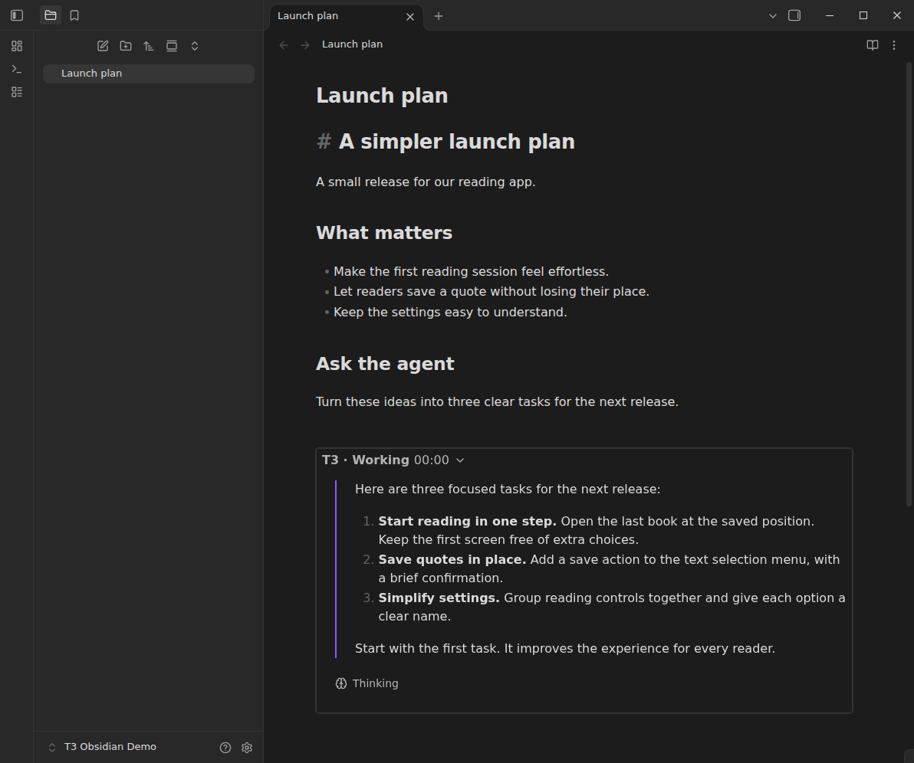
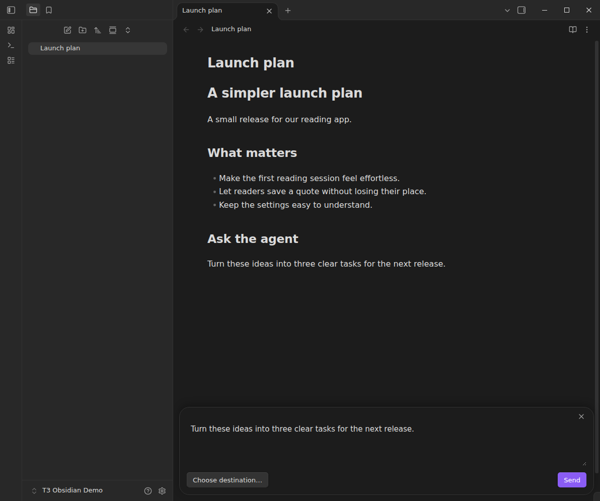

# T3 Code

The **t3-obsidian** plugin brings [T3 Code](https://github.com/pingdotgg/t3code) into your Obsidian notes. Send a note or selection to an agent, ask questions in the editor, and read replies as they arrive.

The plugin appears as **T3 Code** in Obsidian. This is an independent community plugin, with support for desktop and mobile.

The plugin connects to an existing T3 Code environment on this computer or another computer through **T3 Connect (recommended)**, direct HTTPS (including Tailscale HTTPS), or an SSH tunnel set up outside Obsidian. Obsidian is a client; the plugin does not include or start a T3 server.

## Get started

You need Obsidian **1.13.0 or later** and a running T3 Code installation with Orchestrator v2.

1. Install **T3 Code** from **Settings → Community plugins → Browse**, then enable it. Manual installs are available from [GitHub releases](https://github.com/7bgsbm749g-boop/t3-obsidian/releases).
2. In T3 Code, sign in and enable **T3 Connect** on the computer you want to use.
3. Open **Settings → T3 Code → Connection** in Obsidian. Enter your T3 account email, choose **Send sign-in code**, then enter the code and choose **Verify and connect**. Your computers and projects appear automatically. Sign in on each device you use.

For a local, HTTPS/Tailscale, or existing SSH tunnel connection, choose that method under **Settings → T3 Code → Connection** and use a fresh T3 pairing link or code. Start SSH tunnels outside Obsidian.

## Work from your notes

- **Send a note or selection.** Use **Send to agent** from the editor menu, or **T3 Code** from the command palette. Choose a new conversation or continue an existing thread.
- **Open the composer.** Click the floating message icon in the editor. Choose a project and thread, then enter a message. A selection supplies context.
- **Choose where the reply goes.** Editor stream adds a reply block to the note. Inline agent types Markdown at the caret or replaces the selection. Activity stays in the composer, where you can steer the run.
- **Send note content separately.** Enable **Settings / T3 Code / Replies / Beta / Smart Send** to send only new content to the same thread. With Smart Send off, an explicit note send sends the full note.

## Connect notes and projects

- **Link a folder.** Right-click it, choose **Link to T3 Code**, then choose a project. Notes below it use that project when you send them.
- **Import a response.** Use **Import T3 run into this note…** from the editor menu or command palette. Choose an existing response without sending a new message. Search or cancel while earlier runs load. Hover on a run or use the arrow keys to preview its response, including HTML. Status icons keep the list compact, and unavailable runs are hidden. Imports use standard T3 Code connections and preserve the complete saved response.
- **Catch up on responses.** After a response has streamed into a note, use **Catch up on responses** from the editor menu or command palette to import later responses from T3 Code. One thread needs one click. If several threads have streamed into the note, select which ones to catch up on. Existing responses and future stream settings stay the same.
- **Browse project files.** Run **Open Codebase view** from the command palette to work with code, Markdown, images, and supported documents.

Use **Settings → T3 Code → Replies** to adjust reply behaviour, and **Projects** to manage folder links. **Advanced** includes troubleshooting.

**Hide Obsidian threads in T3**, under **Replies**, is off by default. It tags new threads created here with `t3-obsidian` and hides them across connected T3 environments and clients. It also enables T3’s existing hidden-tag filter, including other tags already listed there. Turning it off removes only `t3-obsidian` from that filter; thread tags and other entries remain. Existing threads created outside the plugin are not tagged. New threads can appear briefly before tagging. Unavailable machines and pending tags are checked again when Obsidian reconnects or returns to the foreground.

## Note inbox in the file explorer

Choose the **T3 icon** in the left sidebar's top row, next to **Codebase view**,
to open the note inbox. Choose **Files** to return to the normal file tree.
The inbox includes only existing Markdown notes with a current or past T3 stream. Several streams in a note share one row;
sending a note without attaching a stream does not add it.

The T3 button filters the existing file explorer to notes with stream history.
Notes keep their normal labels, icons, decorations, drag behavior, and file
menus. Pinned notes come first, followed by regular notes. The small **Working**,
**Snoozed**, and **Settled** shelf headers follow T3 Code's sidebar, with a
trailing count and collapse chevron.

Drag a note onto **Pinned** at the top or **Settled** at the bottom of the inbox.
These drop targets appear only while dragging. Drop onto a regular note to
unpin or reopen work. The normal note context menu offers the same actions,
plus snooze and wake.
Running responses and notes that need input must finish before you can settle
or snooze them. New sends return settled work to the inbox; snoozed notes return
when their wake time passes. Completing a response does not settle its note.

Inbox choices follow stream bindings through note moves and use the existing
plugin settings sync. Settling a note also settles each attached T3 thread
on its original machine. Reopening the note reopens those threads. The note
enters Settled only after T3 accepts all required commands; unavailable
threads leave its inbox state unchanged. Note files and their contents stay in place. File explorer mode and section
collapse choices stay on the current device.

## Right sidebar conversations

Use **T3 Code: Open thread in right sidebar…** to select a connected project,
open a regular thread, or start one. Messages sent from this page do not create
note response bindings or enable note streaming. Existing note follows remain
under **Manage T3 streams in this note…**.

From a linked note or an open sidebar conversation, use **Start side chat in
right sidebar**. This creates a hidden T3 side chat from the parent’s latest
stable point. The context breadcrumb returns to the source conversation.
**Bring back** adds a finished side chat to the idle parent’s next message.
The trash control deletes the side chat after confirmation.

Use **View subagent in right sidebar…**, or a child button in a sidebar thread,
to inspect a subagent that exposes a local child thread. This view is read-only;
continue or stop the work from its parent. Tasks without a child thread and
remote child tasks do not offer a local thread page.

All three pages use native Obsidian workspace tabs and theme variables. Close
the tab to stop its live reader. Closing a side chat tab does not delete its T3
conversation. Saved layouts retain open targets and unsent drafts. The sidebar
shows the most recent 200 messages. Approval and question requests still use the
existing T3 controls; the sidebar does not bypass them.

The transcript shares the note stream’s work, tool, and activity presentation
and its conversation connection. Prompts appear as right-aligned bubbles;
completed work folds above the answer. The composer provides image attachments,
provider/model and reasoning options, permissions, plan mode when supported,
and file/skill/command suggestions. Enter sends, Shift+Enter inserts a new line,
and an empty composer shows Stop while a reply runs. Voice input is available
only on devices with browser speech recognition; T3’s remote transcription
service is not yet connected.

## Let agents edit notes

Open **Settings → T3 Code → Agent tools** and choose **Connect MCP**. It sets up enabled, installed Codex, Claude Code, Cursor and OpenCode agents across your connected T3 computers, skipping existing setups. The status shows anything that still needs attention. **Disconnect MCP** removes this plugin’s setup without stopping current sessions or disconnecting T3.

Python 3.10 or later must be available on each T3 computer. Start a new agent session after setup. The tools and editing skill are included; no repository checkout or Python packages are needed. For another MCP client or a custom configuration, open **Advanced → Manual setup** in the same section.

Agents can prepare and submit checked note edits through the running plugin. Compatible changes merge, conflicts are kept for review, and active replies use the same safe final save. Keep Obsidian open and connected while editing.

---

Your chosen note content and attachments go to the connected T3 computer and its configured model provider. Optional thread hiding changes thread tags and visibility settings through T3’s authenticated API across your connected environments; it needs settings-write access. Optional agent setup writes the bundled MCP tools and changes the selected agent’s launch settings on that computer through the authenticated T3 connection, outside the vault. Obsidian does not run the helper or open an incoming command port. T3 and provider accounts or usage charges are separate from this free plugin. [Report an issue](https://github.com/7bgsbm749g-boop/t3-obsidian/issues) · [MIT license](LICENSE)

Streaming RAM capture: [device-local streaming memory diagnostics](docs/stream-memory-diagnostics.md).

### Plugin updates

T3 Code checks its latest published GitHub release at startup and when Obsidian
returns to the foreground or comes online. Background checks run at most once
per six hours. A banner at the top says **Update available for t3-obsidian (vVERSION)**,
shows the GitHub release description and change list, and offers **Update** and
**Dismiss**. Long notes scroll while the buttons stay visible. Releases with no
description show a short fallback message. Dismiss
hides that release on this device; a newer release can show another banner.
Use **T3 Code: Check for plugin updates** to check immediately or show a dismissed
update again. Offline checks stay quiet.

**Update** checks the release manifest, saves open notes and response recovery
data, then calls Obsidian’s native plugin installer to download and install
T3 Code. If the old code is still running, notes are saved again before Obsidian’s
plugin manager reloads it. Settings are preserved, and active streams do not need to finish. The
installed and running versions are checked after installation. Errors stay in the
banner so you can retry; if the old plugin has unloaded, a notice shows the error.
Update checks keep the banner available while installed files wait to load.
If this Obsidian version does not expose its internal installer, update through
Community plugins. Releases that need a newer Obsidian version show an instruction
to update Obsidian first. Development builds are compared by their numeric source
version and are never replaced by an older release.
